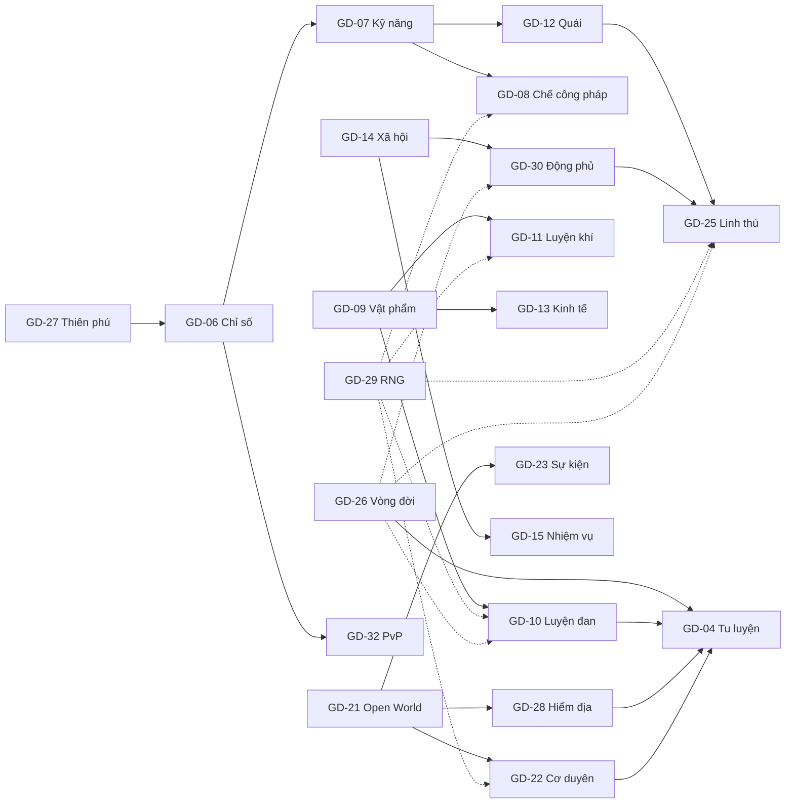

# GD-02 — GDD tổng (mục lục hệ thống)

| Thuộc tính | Giá trị |
|------------|---------|
| Mã tài liệu | GD-02 |
| Owner | Lead Designer |
| Trạng thái | 🟡 Bản nháp v0.2 |
| Mục đích | Bản đồ toàn bộ thiết kế: mỗi hệ thống tóm tắt vài dòng + link tài liệu chi tiết, pha phát hành, phụ thuộc |
| Liên quan | [GD-01 Concept](00-concept.md) · [GD-03 Core Loop](02-core-loop.md) · [docs/README.md](../README.md) (danh mục + quy ước spec) · [PLAN](../../PLAN.md) · [AGENTS.md](../../AGENTS.md) |

> Tài liệu này **không chứa quy tắc**. Mọi quy tắc nằm ở GD / TD được liên kết; khi tóm tắt ở đây lệch tài liệu chi tiết, theo tài liệu chi tiết. Trạng thái phiên bản mới nhất: [docs/README.md](../README.md).

Pha: **MVP** = Alpha · **B1** = Beta 1 · **B2** = Beta 2 · **SL** = sau launch.

---

## 1. Vòng lặp chính
Khám phá (cơ duyên, linh thảo, quái) → chế tác (đan, khí, công pháp) → mạo hiểm (hiểm địa, bí cảnh) → **đột phá** → mở vùng / hệ thống mới → … → hết kiếp (tọa hóa / chết) → **luân hồi**: kiếp mới mạnh hơn nhờ tiến trình tài khoản. Đường cong thời gian và tỷ trọng nguồn tu vi: [GD-03](02-core-loop.md).

---

## 2. Hệ thống

### 2.1. Nhân vật & vòng đời
| Hệ thống | Tóm tắt | Tài liệu | Pha |
|----------|---------|----------|-----|
| **Vòng đời: thọ nguyên · cái chết · luân hồi** | Tuổi trôi theo giờ chơi (1 giờ ≈ 1 năm); chết thật chỉ ở hiểm địa / thiên kiếp / hết thọ, còn lại là trọng thương. Hết kiếp → Bia Vạn Cổ, điểm Luân Hồi, Tàng Bảo Các. Kho đồ + động phủ **phong ấn vào Di Tàng**, kiếp sau đánh tàn hồn để lấy lại. Binh giải trong thiên kiếp. | [GD-26](03-lifecycle.md) | MVP (Di Tàng tầng LK/TC), B2 (tầng KD/NA) |
| **Thiên phú & xuất thân** | Tạo nhân vật roll linh căn, chỉ số bẩm sinh, 3 thiên phú theo độ hiếm; xuất thân (gồm 3 xuất thân gắn tông); thức tỉnh / dung hợp thiên phú qua sự kiện. | [GD-27](04-talents.md) | MVP (thức tỉnh B1) |
| **Tu luyện** | Cảnh giới PN → LK (9 tầng) → TC → KD → NA → HT; tu vi từ đan, cơ duyên, nhiệm vụ, quái (có trần), đả tọa / bế quan; bình cảnh, đan độc, tâm cảnh; đột phá bằng vật phẩm, thử thách tâm ma, thiên kiếp. | [GD-04](10-cultivation.md) | MVP (tới TC), B1 (thiên kiếp, KD) |

### 2.2. Chiến đấu
| Hệ thống | Tóm tắt | Tài liệu | Pha |
|----------|---------|----------|-----|
| **Chỉ số & công thức** | Bảng chỉ số theo cảnh giới (hệ số tăng dần), sát thương, giảm thương, ngũ hành 8 hệ, poise, né / đỡ, status, chiến lực. | [GD-06](12-stats-formulas.md) | MVP |
| **Kỹ năng & công pháp** | Kỹ năng dạng thành phần (hình, lượt trúng, hiệu ứng), máy trạng thái hành động, tâm pháp, thuần thục, ngân sách sức mạnh, bí pháp tiêu thọ. | [GD-07](13-skills.md) | MVP |
| **Quái & AI** | Archetype AI, spawn theo khu / giờ / thời tiết, cảnh báo chiêu bắt buộc, boss theo pha, rơi đồ cá nhân, boss đặc biệt thu phục được. | [GD-12](18-enemies-ai.md) | MVP |
| **PvP dã ngoại & sát nghiệp** | Chế độ PK, người vô tội không mất thọ, sát nghiệp → ác nhân → Chấp Pháp truy sát → Thiên Đạo Hóa Thân; Huyết thù, truy nã. | [GD-32](31-pvp-infamy.md) | B1 |
| **Camera & điều khiển** | Camera chéo 50°, sơ đồ phím chuẩn, hỗ trợ ngắm theo thiết bị, tay cầm, cảm ứng, trợ năng. | [GD-24](25-camera-controls.md) | MVP (cảm ứng SL) |

### 2.3. Thế giới & nội dung
| Hệ thống | Tóm tắt | Tài liệu | Pha |
|----------|---------|----------|-----|
| **Open world & khám phá** | Đại lục → vực → bản đồ 250–400m, kết nối, kênh, fog giữ qua kiếp, Vạn Giới Lục, thần thức quét, ngày / đêm, thời tiết, linh thảo hiếm tranh đoạt. | [GD-21](22-open-world.md) | MVP |
| **Cơ duyên (kỳ ngộ)** | Kích hoạt theo sự kiện gameplay, chọn theo trọng số + khí vận, kịch bản Ink chạy trên server, outcome danh sách trắng, bảo hiểm. | [GD-22](23-encounters.md) | MVP |
| **Hiểm địa** | Vào – lấy – thoát, 4 pha áp lực, hấp hối & cứu, di hài, quy tức khi mất kết nối; Ma Vực (PvP, chết thật). | [GD-28](27-danger-zones.md) | MVP (Ma Vực B2) |
| **Nhiệm vụ** | Engine nhiệm vụ data-driven, chuỗi chính chương 1 (3 nhánh tông), nhiệm vụ tông môn ngày / tuần, lược truyện cho kiếp sau, nhiệm vụ mùa. | [GD-15](21-quests.md) | MVP |
| **Sự kiện thế giới** | Lịch tất định, thưởng theo đóng góp, world boss (top 3 mỗi kênh được thu phục), Tiên Phủ / Ma Uyên theo lịch. | [GD-23](24-world-events.md) | MVP (3 sự kiện), B2 |
| **Ngự kiếm phi hành** | Di chuyển nhanh trên bản đồ (phím N), bay qua vật thấp, vùng cấm bay, không chiến đấu khi bay. | [GD-31](29-sword-flight.md) | B2 |
| Level design từng bản đồ | Mỗi bản đồ / bí cảnh một file: layout, luồng, POI, cơ duyên, checklist mật độ. | GD-16 (⬜ chưa viết) | MVP |

### 2.4. Chế tác & kinh tế
| Hệ thống | Tóm tắt | Tài liệu | Pha |
|----------|---------|----------|-----|
| **Trang bị & vật phẩm** | Cổng inventory duy nhất, 9 ô trang bị, phẩm Phàm → Thần, thuộc tính phụ, bộ, mã lý do ledger hợp nhất, Di Tàng (`SEALED`). | [GD-09](15-items-equipment.md) | MVP |
| **Luyện đan** | Minigame hỏa hầu tất định, thành / bại, phẩm chất, đan văn, cấp nghề + **ký ức nghề / khảo hạch** qua kiếp. | [GD-10](16-alchemy.md) | MVP |
| **Luyện khí** | Rèn (nhịp búa), phân giải; cường hóa, tẩy luyện, thăng phẩm, dị tượng. | [GD-11](17-forging.md) | MVP (rèn), B1 (đầy đủ) |
| **Chế tạo công pháp** | Ghép hạch tâm / nguyên tố / biến thức thành kỹ năng riêng trong ngân sách sức mạnh; ngọc giản tự chế truyền đời. | [GD-08](14-technique-crafting.md) | MVP (Hoàng – Huyền), B1 |
| **Kinh tế** | Linh thạch, nguồn / hố tiền theo thời gian chơi, cửa hàng NPC, đấu giá Vạn Bảo Lâu, giao dịch; Tiên Ngọc tách biệt. | [GD-13](19-economy.md) | MVP (B1 đấu giá) |
| **Linh thú** | Linh chủng + boss đặc biệt thu phục, trứng, kết khế / xuất chiến, lai tạo + biến dị theo độ hiếm, thú qua kiếp. | [GD-25](26-spirit-beasts.md) | B2 |
| **Ngẫu nhiên & công bằng** | 5 loại roll, công khai tỷ lệ, dữ liệu bí mật ở server, pity chuẩn, khí vận không chạm tỷ lệ chính, Thiên Cơ Lục. | [GD-29](05-rng-fairness.md) | MVP |

### 2.5. Xã hội & tài khoản
| Hệ thống | Tóm tắt | Tài liệu | Pha |
|----------|---------|----------|-----|
| **Xã hội** | Tổ đội, chat 6 kênh + lọc, bạn bè; **ba đại tông NPC** (Thanh Vân / Tạc Thiên / Hợp Hoan), phe + danh vọng, tông môn tự lập + tông quy, gói phúc lợi một-chọn, Thiên Bảng Chiến Lực. | [GD-14](20-social.md) | MVP (Thanh Vân), B1 |
| **Động phủ & sơn môn** | Động phủ cá nhân (instance từ cửa động), công trình, Linh Điền, Linh Thú Viên, thủ vệ khi phong ấn; sơn môn tông môn trên bản đồ. | [GD-30](28-caves-sect-sites.md) | B1 (sơn môn B2) |
| **Monetization** | Chỉ cosmetic + tiện ích không sức mạnh, Vấn Đạo Lệnh, không hộp ngẫu nhiên ở launch, thanh toán web / IAP, bảo vệ người chơi. | [GD-19](50-monetization.md) | B2 (cơ bản) |
| **Telemetry & KPI** | ≈150 sự kiện chuẩn, KPI một mạng (thời gian sống, tỷ lệ chơi lại sau khi chết), kinh tế, công bằng, chính sách A/B. | [GD-20](51-analytics.md) | MVP |
| UI/UX, Onboarding | Wireframe, HUD, 30 phút đầu. | [GD-17](40-ui-ux.md), [GD-18](41-onboarding.md) | MVP |

### 2.6. Lore & kỹ thuật (tham chiếu)
- Lore: [LR-01 World Bible](../lore/world-bible.md), [Glossary](../lore/glossary.md) (định danh bắt buộc trong code).
- Kỹ thuật: [TD-01](../tech/00-tdd.md) kiến trúc · [TD-02](../tech/01-network.md) mạng · [TD-03](../tech/02-database.md) DB · [TD-04](../tech/03-api.md) API · [TD-05](../tech/04-client.md) client · [TD-06](../tech/05-game-server.md) game server · [TD-07](../tech/06-gamedata.md) gamedata · [TD-08](../tech/07-security.md) bảo mật · [TD-09](../tech/08-infra-ops.md) vận hành · [TD-10](../tech/09-conventions.md) quy ước code / AI · [TD-11](../tech/10-performance.md) hiệu năng · [TD-12](../tech/11-world-maps.md) thế giới · [TD-13](../tech/12-map-editor.md) bản đồ · [TD-14](../tech/13-geom2d.md) hình học · [TD-15](../tech/14-oss-register.md) license.

---

## 3. Phụ thuộc giữa các hệ thống

| Tài liệu nền (đọc trước) | Tài liệu dùng nó nhiều nhất |
|--------------------------|-----------------------------|
| GD-26 Vòng đời | GD-04, GD-28, GD-30, GD-25, GD-10 (ký ức nghề), GD-32 |
| GD-06 / GD-07 Chiến đấu | GD-12, GD-08, GD-25, GD-32, GD-24 |
| GD-09 Vật phẩm | GD-10, GD-11, GD-13, GD-28, GD-19 |
| GD-29 RNG | Mọi hệ thống có roll |
| GD-21 Open World | GD-22, GD-23, GD-28, GD-30, GD-31, TD-12, TD-13 |

---

## 4. Quyết định thiết kế đã chốt (tóm tắt — đầy đủ ở [PLAN §11](../../PLAN.md))

| | Quyết định |
|---|-----------|
| D-01 | 2.5D: 3D low-poly phong cách hóa, camera chéo, logic trên mặt phẳng 2D |
| D-02 | Open world chia bản đồ, chuyển < 2s, kênh 100–150 người |
| D-03 | Một mạng + thọ nguyên + luân hồi; chết thật chỉ ở hiểm địa / thiên kiếp lethal |
| D-04 | Thiên phú & xuất thân ngẫu nhiên, roll lại có giới hạn |
| D-05 | Tu luyện dựa trên vật phẩm / đan; tu vi đánh quái có trần |
| D-06 | API Service + Game Server, PostgreSQL + Valkey, React UI (sửa bởi D-19) |
| D-07 | Launch Việt Nam trước, i18n từ đầu |
| D-08 | MVP: preset ngoại hình + đổi màu |
| D-09 | Camera cố định ở MVP |
| D-10 | WASD mặc định, click-to-move tùy chọn |
| D-11 | 1 giờ chơi ≈ 1 năm; người chơi trung bình đạt Trúc Cơ – Kim Đan trong 40–80 giờ |
| D-12 | 1 nhân vật sống / tài khoản / server |
| D-13 | Bảo hộ tân thủ kiếp đầu (không chết thật trước Trúc Cơ) |
| D-14 | Fog of war giữ qua kiếp |
| D-15 | Tự đặt tên công pháp, có lọc + báo cáo |
| D-16 | Không dùng RPG-JS làm nền |
| D-17 | Không bán thứ giảm rủi ro chết / kéo dài thọ; cosmetic gắn tài khoản |
| D-18 | Team có Content Designer, 3D artist low-poly |
| D-19 | Kiến trúc lai: client + Game Server TypeScript (Colyseus), Spring Boot là nguồn sự thật |
| D-20 | Chết không mất trắng: Di Tàng phong ấn + tàn hồn, động phủ + thú canh cửa |
| D-21 | PvP dã ngoại có kiểm soát (sát nghiệp, Chấp Pháp, Thiên Đạo Hóa Thân) |
| D-22 | Giữ 3D phong cách hóa + Babylon.js; mỹ thuật ưu tiên AI; một codebase web → mobile |
| D-23 | Dựng mới bằng starter chính thức, T5C chỉ tham khảo |
| D-24 | Valkey thay Redis |

---

## 5. Thứ tự đọc

**Người mới vào team (thiết kế / sản xuất):** GD-01 → GD-02 (tài liệu này) → GD-03 → LR-01 → GD-26 → GD-04 → GD-21 → GD-22 → GD-28 → các hệ thống mình phụ trách.

**Lập trình viên / AI sinh code:** [AGENTS.md](../../AGENTS.md) → Glossary → TD-01 → TD-10 → TD liên quan (02/03/04/05/06/07/12/13/14) → GD của hệ thống đang làm → các GD trong mục "Liên quan" của nó.

**Nhà đầu tư / đối tác:** GD-01 → PLAN §1–§3, §7 (lộ trình) → GD-19.

---

## Lịch sử thay đổi

| Phiên bản | Ngày | Người sửa | Nội dung |
|-----------|------|-----------|----------|
| v0.1 | 2026-10-25 | — | Bản nháp đầu: vòng lặp chính, mục lục 26 hệ thống theo 6 nhóm (tóm tắt, link, pha), sơ đồ phụ thuộc, tóm tắt D-01..D-24, thứ tự đọc theo vai trò |
| v0.2 | 2026-10-25 | — | Liên kết GD-17, GD-18 |