# LR-02 — Nhân vật

| Thuộc tính | Giá trị |
|------------|---------|
| Mã tài liệu | LR-02 · Prefix ID: `CHR` |
| Owner | Lead Writer + Content Designer (duyệt: Director) |
| Trạng thái | 🟡 Bản nháp v0.6 |
| Cần trước | Phase 1 (PLAN §8.2); hồ sơ chương 1 cần trước khi viết Ink cho `QC_MAIN_V1_*` (Phase 2) |
| Quyết định nền | [LR-01](world-bible.md) §1 (luật lore bất biến), §2 (giọng văn, quy tắc đặt tên), §6 (thế lực), §7 (nhân vật chủ chốt); GD-14 §5.4b (ba đại tông), SO-R-045B; GD-32 PK-R-056 (danh hiệu Tạc Thiên); GD-15 §5.10 (chương 1) |
| Liên quan | [LR-01 World Bible](world-bible.md) · [LR-03 Story Outline](story-outline.md) · [Glossary](glossary.md) · [GD-14 Xã hội](../design/20-social.md) · [GD-15 Nhiệm vụ](../design/21-quests.md) · [GD-18 Onboarding](../design/41-onboarding.md) · [GD-22 Cơ duyên](../design/23-encounters.md) · [GD-26 Vòng đời](../design/03-lifecycle.md) · [GD-27 Thiên phú](../design/04-talents.md) · [GD-32 PvP](../design/31-pvp-infamy.md) · [GD-12 Quái](../design/18-enemies-ai.md) · [GD-13 Kinh tế](../design/19-economy.md) · [TD-07 Gamedata](../tech/06-gamedata.md) §4.3 · LR-04 Kịch bản |

> Tài liệu này là **nguồn sự thật về NPC có tên**: ai, ở đâu, nói thế nào, biết gì, giấu gì. Khi viết lời thoại / nhiệm vụ / cơ duyên bằng AI: đọc LR-01 §1, §2, §11 → §1 và §2 của tài liệu này → hồ sơ NPC liên quan (§3). **Không** tự thêm NPC, tên, cảnh giới, quan hệ ngoài tài liệu này — thiếu thì ghi câu hỏi mở (§7).
>
> Mã NPC ghi **(có sẵn)** là đã xuất hiện trong GD / glossary; ghi **(đề xuất)** là LR-02 đề xuất, cần đăng ký vào glossary §19–§21 và gamedata (`shared/maps`, `social/npc_sects`) trước khi dùng (WB-R-010, TD-07 DT-R-051). Tên người mới cần thêm vào LR-01 §7 (WB-R-010).

**Tài liệu này cung cấp cho các tài liệu khác:**

| Tài liệu gọi | Cần gì từ LR-02 | Mục |
|--------------|-----------------|-----|
| GD-15, LR-04 | `giverNpcId`, giọng nói, thoại mẫu, biến thể theo tông (`quest_branch`) | §2, §3, §4 |
| GD-22 | NPC xuất hiện trong cơ duyên (`npcModel`), bí mật để rải | §3 |
| GD-14, GD-32 | Lãnh đạo ba đại tông, danh hiệu phe trên đầu NPC, phản ứng với phản đồ / ác nhân | §1, §3.3–§3.6 |
| GD-13 | Chủ cửa hàng `SHOP_V1_*` | §3.7 |
| LR-03 | Phản diện, nhân vật bí ẩn, mạch quan hệ | §3.9–§3.10, §5 |
| AR-01, AU-01 | Tính cách, ngoại hình gợi ý, giọng | §3 |

---

## 1. Quy tắc nhân vật

### 1.1. Định danh

| Mã | Quy tắc |
|----|---------|
| **CHR-R-001** | Mọi NPC có tên dùng tiền tố **`NPC_`** (TD-07 DT-R-051), đúng mẫu DT-R-050 (`^[A-Z][A-Z0-9]*(_[A-Z0-9]+)+$`, ≤ 48 ký tự, không dấu), **duy nhất toàn cục** (DT-R-052). |
| **CHR-R-002** | **Giữ nguyên mọi mã đã có** trong GD / glossary (`NPC_V1_LAO_DAO`, `NPC_V1_SECT_ELDER`, `NPC_VAULT_KEEPER`, `NPC_BEAST_KEEPER`, `NPC_ALCHEMY_ELDER`, `NPC_FORGE_ELDER`, `NPC_OLD_FISHERMAN`, `NPC_TAC_THIEN_CHIEF`, `NPC_TAC_THIEN_ELDER_*`). Mã đề xuất mới theo ba nhóm (khớp cách các mã có sẵn đang đặt): **(a)** NPC chức năng dùng ở mọi thành trấn: `NPC_{VAI}` (vd. `NPC_VAULT_KEEPER`); **(b)** lãnh đạo / nhân vật của một đại tông, đi theo tông qua các vực: `NPC_{THANH_VAN\|TAC_THIEN\|HOP_HOAN}_{VAI}` (vd. `NPC_TAC_THIEN_CHIEF`); **(c)** NPC gắn một vực / bản đồ: `NPC_V{n}_{VAI hoặc TÊN}` hoặc `NPC_V{n}_F{nn}_{VAI}` (vd. `NPC_V1_LAO_DAO`). Xem CHR-Q-1. |
| **CHR-R-003** | Quái / boss có lời thoại (Hồ Yêu Mẫu, Kiếm Hồn) giữ mã **`MON_B_*`** của GD-12; LR-02 chỉ thêm hồ sơ lore, **không** tạo mã `NPC_` song song. Linh thú thu phục giữ `BST_*` (GD-25). |
| **CHR-R-004** | Mã NPC **không** chứa tên thật khi tên thật là bí mật (vd. Tạc Thiên Đại Đế → `NPC_TAC_THIEN_CHIEF`, không `NPC_MAC_KINH`), để dữ liệu client không lộ cốt truyện. |

### 1.2. Đặt tên

| Mã | Quy tắc |
|----|---------|
| **CHR-R-010** | Theo LR-01 §2: người = **họ 1 chữ + tên 1–2 chữ** Hán Việt; tu sĩ có tuổi / địa vị có thể dùng **đạo hiệu 2 chữ + "chân nhân / tán nhân / lão tổ"** hoặc tôn xưng "phu nhân" (đã có tiền lệ *Mộng Hoa Phu Nhân*). Yêu thú thành tinh: tên hình dạng + "Yêu / Vương / Mẫu". |
| **CHR-R-011** | Phàm nhân được gọi bằng **biệt danh dân dã** đi kèm tên đầy đủ trong hồ sơ: "Lão X", "X bá", "X cô", "X tẩu" (vd. *Tào lão*, *Lương bá*). |
| **CHR-R-012** | **Tự sáng tác** (PLAN R10): không dùng trùng họ + tên, đạo hiệu, biệt hiệu của nhân vật trong truyện / phim / game tiên hiệp nổi tiếng; không dùng tên nhân vật lịch sử, thần thoại, tôn giáo có thật (WB-R-008). Trước khi đăng ký tên mới: tra cứu nhanh tên đầy đủ; trùng thì đổi. |
| **CHR-R-013** | Không hai NPC cùng **họ + tên**; tránh hai NPC chính cùng họ trong một vực trừ khi có quan hệ huyết thống ghi trong hồ sơ. |
| **CHR-R-014** | Danh hiệu phe trên đầu NPC: chỉ dùng danh hiệu **đã có trong spec** (Tạc Thiên Tôn Giả / Chí Tôn / Đại Đế — GD-32 PK-R-056; Nghịch Thiên; Nghịch Mệnh). Danh hiệu phe của Thanh Vân Tông / Hợp Hoan Tông **chưa thiết kế** (SO-R-045B) → NPC của hai tông chỉ mang chức vị (Chưởng môn, Trưởng lão, Thánh nữ…), không mang danh hiệu phe. |

### 1.3. Cảnh giới và năng lực

| Mã | Quy tắc |
|----|---------|
| **CHR-R-020** | Cảnh giới NPC ghi bằng `RealmCode` (glossary §2, vd. `KD3`). **NPC đang sống ở Vực 1 không vượt Kim Đan** (WB-R-004); chỉ **tàn hồn / tàn niệm / bóng ma của người đã khuất** mới được mạnh hơn, và không bao giờ "sống lại" (WB-R-002). |
| **CHR-R-021** | NPC Kim Đan ở Vực 1 là **số ít có tên trong §3** (chưởng môn / tông chủ / bang chủ, một số trưởng lão, ẩn tu). Không viết thêm NPC Kim Đan ở Vực 1 mà không cập nhật tài liệu này. |
| **CHR-R-022** | Mọi NPC có **thọ nguyên** theo cảnh giới (LR-01 §5) và tuổi ghi trong hồ sơ phải nằm trong thọ đó (WB-R-003). Không ai trong thời Phục Linh sống từ Đoạn Thiên Chi Chiến (~3.000 năm). |
| **CHR-R-023** | NPC dùng nguyên tố trong 8 hệ (WB-R-005); không hệ khác. |

### 1.4. Giọng nói và lời thoại

| Mã | Quy tắc |
|----|---------|
| **CHR-R-030** | Mỗi NPC theo **giọng nhóm** (§2) + nét riêng ghi trong hồ sơ. Một lượt nói **≤ 3 câu** (LR-01 §11). |
| **CHR-R-031** | NPC **không** xưng "tôi / bạn", không nói "người chơi / game / server / cấp độ / chỉ số", không đọc con số cân bằng (tỷ lệ, sát thương, giá) — UI hiển thị từ gamedata (LR-01 §2, §11). |
| **CHR-R-032** | **Thiên Đạo và Thiên Đạo Hóa Thân không nói** (WB-R-001). NPC nói *về* Thiên Đạo theo lập trường phe (§2), không nhân cách hóa thành thần có cảm xúc. |
| **CHR-R-033** | Lời thoại phản ứng theo **trạng thái nhân vật người chơi** chỉ qua biến / hàm đã có: `realm_code`, `realm_order`, `generation`, `background_id`, `karma`, `player_name` (GD-22 ENC-R-061), `npc_sect_rank`, `quest_branch` (GD-15 QS-R-040), `HAS_FLAG`, `HAS_ITEM`, `HAS_TALENT` (QS-R-041). Không đòi biến mới. |
| **CHR-R-034** | **Phản đồ:** NPC của tông cũ đổi lời thoại khi nhân vật đã phản môn (GD-14 SO-R-047) — lạnh nhạt, không giao nhiệm vụ của tông, không truy sát (MVP). |
| **CHR-R-035** | **Ác nhân:** NPC trong vùng an toàn của thành trấn từ chối phục vụ nhân vật `RED`+ (GD-32); NPC trong **Tạc Thiên Trại** vẫn tiếp và có câu thoại riêng ("đất dung thân", GD-32). |
| **CHR-R-036** | **Danh hiệu Tạc Thiên:** NPC Tạc Thiên Bang có ba nhánh thoại theo danh hiệu của người chơi (GD-32 PK-R-056): chưa có → coi thường; ngang Trưởng lão (Tôn Giả / Chí Tôn) → gọi "đạo hữu"; **Tạc Thiên Đại Đế** → Bang chủ đối xử ngang hàng (cảnh "đối ẩm", chỉ biểu tượng). |

### 1.5. Nội dung và quan hệ

| Mã | Quy tắc |
|----|---------|
| **CHR-R-040** | **Không có tình cảm lãng mạn bắt buộc:** không nhiệm vụ / tiến trình nào yêu cầu người chơi tán tỉnh, kết đôi, hay đáp lại tình cảm của NPC. NPC không tỏ tình với nhân vật người chơi. Tình nghĩa (sư đồ, đồng môn, tri kỷ, ân oán) được phép và được khuyến khích. Game **không** có cơ chế quan hệ tình cảm với NPC. |
| **CHR-R-041** | **Hợp Hoan Tông** (WB-R-007, GD-14 SO-R-04A): "song tu" = cùng tu luyện, đồng tâm; mị thuật = nghệ thuật lay động tâm trí, thể hiện qua hiệu ứng và lời lẽ ẩn ý **không** gợi dục; trang phục, cử chỉ theo AR-01. NPC Hợp Hoan **không** dùng sắc đẹp để mua chuộc hay dụ dỗ nhân vật người chơi. |
| **CHR-R-042** | **Tạc Thiên Bang:** nghĩa khí giang hồ, bất kham với trời; không cổ súy tội ác ngoài đời thực (WB-R-007); "phí bảo kê", "hàng lậu" được kể kiểu giang hồ tiên hiệp, không chi tiết hóa bạo lực. |
| **CHR-R-043** | **Đạo đức xám** (WB-R-006): mỗi phe có người tốt người xấu; mỗi NPC chính có **ít nhất một điểm đáng thương hoặc đáng trách**. Phe không quyết định thiện ác. |
| **CHR-R-044** | **Bí mật rải dần** (LR-01 §11): mỗi hồ sơ ghi "Bí mật" kèm **mức tiết lộ** (chương / phase); một nội dung (nhiệm vụ, cơ duyên) không tiết lộ trọn một bí mật lớn. Bảng tiết lộ chung ở LR-03 §5. |
| **CHR-R-045** | **Thế giới dùng chung:** hành động của một người chơi **không** giết, đổi phe, hay đổi vị trí NPC cho người khác (không có cơ chế "phasing" theo người). Thay đổi trạng thái NPC chỉ xảy ra ở **cấp thế giới** qua bản cập nhật nội dung theo phase (LR-03 STY-R-007). Kết cục riêng của từng người chơi thể hiện qua **lời thoại** theo cờ / nhánh (CHR-R-033). |
| **CHR-R-046** | **Chân linh qua kiếp:** NPC thường nói với nhân vật như một con người của kiếp này. Chỉ **ba NPC được phép cảm nhận chân linh** (dùng biến `generation`, cờ `FLAG_ACC_*`): Thủ kho Tàng Bảo Các, Lão Đạo, Kiếm Hồn — và luôn nói **mơ hồ** ("dường như đã gặp"), không xác nhận "ngươi là X kiếp trước" (WB-R-002, LR-01 §3.4: ký ức chỉ là mảnh vụn). |
| **CHR-R-047** | Cảnh **tọa hóa, binh giải, tàn hồn, Bia Vạn Cổ**: NPC nói trang nghiêm, không đùa (LR-01 §2, §11), kể cả NPC vốn hài hước. |

---

## 2. Giọng nói theo nhóm

| Nhóm | Xưng (tự xưng → gọi người chơi) | Giọng | Từ khóa nên dùng | Tránh | Câu mẫu chung |
|------|----------------------------------|-------|------------------|-------|---------------|
| **Thanh Vân Tông** (chính) | "bản tọa / lão phu / sư huynh / sư tỷ" → "tiểu bối / sư đệ / sư muội / đệ tử" | Trang trọng, quy củ, câu tròn ý; cấp trên ngắn gọn, ra lệnh; đôi khi kẻ cả với người xuất thân thấp | tông quy, kiếm tâm, thanh danh, môn hạ, chính đạo | Chửi thề, đùa cợt suồng sã | *"Kiếm tâm như vân. Tâm chưa tĩnh, kiếm sao thẳng."* |
| **Tạc Thiên Bang** (tà) | "lão tử / ta / bổn đại gia / đây" → "tiểu tử / nhóc / huynh đệ / đạo hữu" (theo danh hiệu) | Thô mộc, sảng khoái, tiếng cười lớn, châm chọc trời đất và chính đạo; trọng lời hứa | huynh đệ, nghĩa khí, đục trời, công đạo, thợ mỏ, rượu | Tục tĩu, cổ súy tội ác thật (CHR-R-042) | *"Trời không dung ta? Vậy ta đục trời ra mà sống!"* |
| **Hợp Hoan Tông** (ma) | "thiếp / tỷ tỷ / bổn tọa / ta" → "tiểu đệ / tiểu muội / đạo hữu / người có duyên" | Mềm mỏng, ẩn ý, nhiều hình ảnh hoa – trăng – nước; nói tình nghĩa, đồng tâm; khó đoán ý thật | duyên, đồng tâm, tình nghĩa, hoa đào, tâm cảnh | Gợi dục, lả lơi (CHR-R-041) | *"Một người tu là con đường. Hai người đồng tâm, đường ấy mới có hoa."* |
| **Chấp Pháp Đường** | "bản sứ / bản tọa / Chấp Pháp Đường" → "ngươi / kẻ kia / tội nhân" (ác nhân) | Lạnh, pháp điều, câu khẳng định không cảm xúc; tự xem mình là "thay trời hành pháp" | thiên ấn, luật trời, tội, phạt, sám hối | Tỏ ra dao động công khai | *"Máu người vô tội chưa khô. Chấp Pháp Đường đã tới."* |
| **Vạn Bảo Lâu / thương nhân** | "tại hạ / tiểu điếm / lão hủ" → "khách quan / quý khách / đạo hữu" | Khéo léo, niềm nở, nói vòng, luôn quy về giá trị và chữ tín; trung lập | chữ tín, giá trị, hàng thật, đôi bên cùng lợi | Đọc giá cụ thể (CHR-R-031), đứng về phe nào | *"Vạn Bảo Lâu chỉ bán chữ tín. Hàng thì… khách quan tự xem."* |
| **Phàm nhân** (thôn dân, thợ mỏ, ngư dân) | "lão / già này / cháu / tôi tớ" → "tiên sư / tiểu tiên trưởng / cậu / cô" | Mộc mạc, hài hước nhẹ, kính sợ tu sĩ, kể chuyện đời thường; thường là nguồn cơ duyên (LR-01 §6.2) | mùa màng, mưa, cá, trúc, mỏ, con cháu | Thuật ngữ tu luyện sâu | *"Tiểu tiên trưởng ăn miếng cơm đã. Tu tiên cũng phải no bụng chứ."* |
| **Tán tu / ẩn sĩ** | "lão phu / bần đạo / ta" → "tiểu hữu / người trẻ" | Ẩn dụ, chậm, ít lời, hay nói về thời gian, thọ nguyên | thời gian, duyên, tĩnh, mưa, sông | Giải thích dài | *"Câu cá không cần mồi. Câu người cần duyên."* |
| **Tàn hồn / cổ nhân** (Kiếm Hồn, bia đá) | "ta / bổn tọa" → "hậu bối / kẻ đến sau" | Cổ kính, đứt đoạn, lặp từ, trang nghiêm, buồn | ba nghìn năm, kiếm, trời, phong ấn, tiên lộ | Hài hước; giải thích rõ ràng | *"Ba nghìn năm… kiếm vẫn chưa nguội."* |
| **Yêu thú thành tinh** (Hồ Yêu Mẫu) | "bổn tọa / ta" → "nhân loại / ngươi" | Kiêu, hoang dã, ngắn, bảo vệ bầy; phân biệt rõ ân và oán | bầy, núi, trăng, thợ săn, giao ước | Lời lẽ của người tu luyện chính thống | *"Nhân loại các ngươi gọi đó là săn. Bổn tọa gọi là giết con."* |

---

## 3. Hồ sơ NPC chính (Vực 1 / MVP)

**Cách đọc hồ sơ:** mỗi NPC có bảng thuộc tính → tính cách → giọng nói + 2–3 câu thoại mẫu → quan hệ → bí mật (mức tiết lộ). "Phase xuất hiện" theo roadmap PLAN §7: **Alpha** (nội dung MVP, Phase 2–4) · **Beta 1** (Phase 5a: Tạc Thiên Bang, Hợp Hoan Tông, PvP + Chấp Pháp, Vạn Bảo Lâu) · **Beta 2** (Phase 5b: linh thú, Vực 2, sự kiện thế giới động) · **Sau launch**.

### 3.1. Dẫn dắt mở đầu

#### CHR-NPC-001 · Lão Đạo — Mặc Trần Tán Nhân

| Thuộc tính | Giá trị |
|---|---|
| Mã | `NPC_V1_LAO_DAO` (có sẵn — GD-15 §7) |
| Tên | Tục danh **Ôn Cửu**; đạo hiệu **Mặc Trần Tán Nhân**; người trong vùng gọi "Lão Đạo" |
| Danh hiệu | — |
| Thế lực | Tán tu |
| Cảnh giới | `LK9` (kẹt bình cảnh hơn sáu mươi năm); tuổi ~115 / thọ ~120 |
| Vị trí | `V1_F01` — miếu hoang và bãi tập trong Thanh Trúc Lâm (điểm xuất phát của **mọi** xuất thân — GD-27 TLN-R-032) |
| Vai trò gameplay | Giao `QC_TUTORIAL_QI` (bước 1) và `QC_MAIN_V1_JOIN_SECT` (`giverNpcId`, GD-15 §7) — chỉ đường ra Cửa rừng, báo "sư huynh Thanh Vân đón ở trấn"; lời dẫn cảnh mở đầu (GD-18 bước 3–4) |
| Phase | Alpha |

**Tính cách.** Hiền, lười, thích uống trà trúc, nói chuyện như đùa mà câu nào cũng có ý. Cả đời không qua được Trúc Cơ nên quý thời gian của người trẻ hơn ai hết. Không tham, không giữ ai bên mình — chỉ đưa người ta ra khỏi rừng trúc rồi quay về miếu.

**Giọng nói.** Tán tu (§2): chậm, ẩn dụ, hay nhắc thọ nguyên; xưng "lão phu", gọi "tiểu hữu".
> "Mưa to thế mà tiểu hữu chui vào miếu này… Ngọc giản kia nằm đó ba mươi năm, chẳng ai thèm nhặt."
>
> "Linh khí trời đất là gốc tu hành. Ngồi xuống, thở chậm thôi — vội vàng là tiêu thọ nguyên."
>
> *(`generation ≥ 2`)* "Lạ thật… ánh mắt tiểu hữu, lão phu dường như đã thấy ở đâu rồi."

**Quan hệ.** Bạn trà lâu năm của Thủ kho Tàng Bảo Các (CHR-NPC-040); quen Lâm Thanh Phong từ khi cậu còn là tạp dịch đi hái trúc; kính mà ngại Thanh Vân Tông (từng bị từ chối nhập môn vì "tư chất kém").

**Bí mật.** Ba mươi năm nay ông được Thủ kho nhờ **canh mảnh ngọc giản trong miếu** và đưa "người chạm vào nó" ra trấn — ông không biết vì sao, chỉ biết những người ấy "trở lại, rồi lại trở lại". *(Gợi ý: chương 1; trọn vẹn: chương 2.)*

#### CHR-NPC-002 · Lâm Thanh Phong (Lâm sư huynh)

| Thuộc tính | Giá trị |
|---|---|
| Mã | `NPC_V1_LAM_THANH_PHONG` (đề xuất) |
| Tên | **Lâm Thanh Phong** (LR-01 §7) |
| Danh hiệu | Đại sư huynh tiếp dẫn tân đệ tử |
| Thế lực | Thanh Vân Tông — **đại sư huynh ngoại môn** (bậc `NGOAI_MON`; còn Luyện Khí nên chưa đủ điều kiện nội môn `TC1` — GD-14 SO-R-042, LR-01 §7) |
| Cảnh giới | `LK9` (bình cảnh, đang tích cống hiến đổi Trúc Cơ Đan); tuổi ~26 |
| Vị trí | `V1_HUB` — khu tông môn, cạnh bảng nhiệm vụ. **Vị trí cố định duy nhất** (CHR-R-045): không đặt POI ở `V1_F01`; ở Cửa rừng người mới được Lão Đạo chỉ đường (GD-16 `V1_F01` §5.1) |
| Vai trò gameplay | Đón người mới khi tới Thanh Vân Trấn (bước 1 `QC_MAIN_V1_JOIN_SECT` hoàn thành khi tới `V1_HUB`); đề xuất giao `QC_MAIN_V1_04`, `QC_MAIN_V1_15`; giới thiệu bảng nhiệm vụ tông môn (`QC_MAIN_V1_05`) — dẫn mọi người chơi tới trấn kể cả khi họ sau đó chọn Tạc Thiên / Hợp Hoan **Chủ trì Trận Thử Tâm** (bước S2 `QC_MAIN_V1_JOIN_SECT`, `dialogueNpcId` — GD-15 QS-R-056). |
| Phase | Alpha |

**Tính cách.** Nhiệt tình, chăm chỉ, hơi nóng vội; tự ti về xuất thân tạp dịch nên làm gì cũng gấp đôi người khác. Tin tông môn tuyệt đối — cho tới khi biết chuyện mỏ Hoang Thạch.

**Giọng nói.** Thanh Vân Tông, lớp trẻ: thân thiện, xưng "sư huynh", gọi "sư đệ / sư muội" (sau khi người chơi gia nhập Thanh Vân) hoặc "đạo hữu" (tông khác).
> "Từ rừng trúc ra đấy à? Đi theo ta! Thanh Vân Sơn ở ngay sau trấn — mây trên đỉnh trắng như kiếm vậy."
>
> "Ta từng gánh nước cho Tàng Kinh Các bảy năm. Trúc Cơ… chỉ còn một viên đan nữa thôi."
>
> *(`quest_branch == "TAC_THIEN"`)* "Ngươi… chọn bọn đục trời ấy sao? Thôi, đường ai nấy đi. Nhớ giữ mạng."

**Quan hệ.** Đệ tử của Truyền Công Trưởng Lão Hà Tri Viễn (CHR-NPC-012); ông nội từng là cai mỏ ở Hoang Thạch Khoáng, chết trong vụ sập hầm (CHR-NPC-061 biết rõ); ngưỡng mộ Chưởng môn Vân Hạc; e dè Giới Luật Trưởng Lão Lục Trọng Sơn.

**Bí mật.** Cậu không biết ông nội mình là một trong những người bị **bỏ lại sau trận phong** trong hầm. Khi biết (chương 1, `QC_MAIN_V1_07`), cậu dao động giữa lòng trung với tông và công đạo cho người nhà — lời thoại từ đó đổi theo cờ kiếp người chơi đặt ở `QC_MAIN_V1_07`. *(Tiết lộ: chương 1.)*

### 3.2. Thanh Vân Tông

#### CHR-NPC-010 · Vân Hạc Chân Nhân

| Thuộc tính | Giá trị |
|---|---|
| Mã | `NPC_THANH_VAN_CHIEF` (đề xuất) |
| Tên | Đạo hiệu **Vân Hạc Chân Nhân** (LR-01 §6.1); tục danh **Hứa Hạc Niên** (chỉ lộ ở chương sau) |
| Danh hiệu | Chưởng môn Thanh Vân Tông (đời thứ chín) |
| Thế lực | Thanh Vân Tông (`SECT_THANH_VAN`, `CHINH`) |
| Cảnh giới | `KD3` (Kim Đan hậu kỳ — LR-01 §6.1); tuổi ~310 |
| Vị trí | `V1_HUB` — điện chính Thanh Vân Sơn (khu tông môn) |
| Vai trò gameplay | NPC cốt truyện: lời chúc ở cuối `QC_MAIN_V1_15` (nhánh Thanh Vân), hội thoại lore; **không** cửa hàng, không giao nhiệm vụ hằng ngày |
| Phase | Alpha |

**Tính cách.** Ôn hòa, chậm rãi, chu toàn; giỏi giữ thể diện cho tông môn. Thật lòng muốn Thanh Vân trường tồn — và chính vì thế từng chọn im lặng. Không độc ác, nhưng hèn ở đúng một chuyện.

**Giọng nói.** Thanh Vân, bậc tôn trưởng: ít lời, câu tròn ý, xưng "bản tọa", gọi "tiểu bối / đệ tử".
> "Thanh Vân lập tông bốn trăm tám mươi năm. Thứ giữ được nó không phải kiếm, mà là thanh danh."
>
> "Trúc Cơ rồi sao… tốt. Đạo cơ vững, đường còn dài. Đừng như những kẻ vội vàng năm xưa."
>
> *(cờ kiếp đã trình chứng cứ vụ sập hầm)* "…Ngươi muốn bản tọa nói gì? Rằng bốn mươi năm qua, đêm nào bản tọa cũng nghe tiếng đá rơi?"

**Quan hệ.** Sư huynh đồng môn của Lục Trọng Sơn (CHR-NPC-014); cấp trên của Hà Tri Viễn, Đỗ Hoài Sương; hợp tác với Chấp Pháp Đường; coi Tạc Thiên Đại Đế là "thổ phỉ" nhưng chưa bao giờ dám đối mặt hắn; đề phòng Mộng Hoa Phu Nhân.

**Bí mật.** Bốn mươi năm trước, khi còn là trưởng lão, ông **phê chuẩn sau** quyết định phong hầm của Lục Trọng Sơn và chôn hồ sơ để giữ thanh danh tông (LR-01 §7). Ông không biết Lục đã lấy được gì trong hầm. *(Gợi ý: chương 1; thừa nhận: chương 2–3, tông môn nội đấu.)*

#### CHR-NPC-012 · Hà Tri Viễn — Truyền Công Trưởng Lão

| Thuộc tính | Giá trị |
|---|---|
| Mã | `NPC_V1_SECT_ELDER` (có sẵn — GD-15 §7) |
| Tên | **Hà Tri Viễn** |
| Danh hiệu | Truyền Công Trưởng Lão |
| Thế lực | Thanh Vân Tông |
| Cảnh giới | `TC4`; tuổi ~190 |
| Vị trí | `V1_HUB` — Truyền Công Điện, cạnh Tàng Kinh Các |
| Vai trò gameplay | Lễ bái sư bước 3 `QC_MAIN_V1_JOIN_SECT` (nhánh Thanh Vân); đề xuất giao `QC_MAIN_V1_05` (bảng nhiệm vụ tông môn, Bảo Khố); hướng dẫn tới Ngộ Đạo Thạch khi đạt `TC1` (GD-18 §6) |
| Phase | Alpha |

**Tính cách.** Nghiêm, công bằng, mê sách; coi trọng ngộ tính hơn xuất thân — trái với nhiều người trong tông. Giận thì im lặng, vui thì gõ quạt.

**Giọng nói.** Thanh Vân, thầy dạy: rõ ràng, có chút giáo huấn.
> "Vào Thanh Vân, trước học quy củ, sau mới học kiếm. Tông quy ba điều, ghi vào lòng."
>
> "Ngộ Đạo Thạch không dạy ngươi chiêu thức. Nó chỉ cho ngươi thấy chiêu thức vốn ở đâu."
>
> *(phản đồ, CHR-R-034)* "Truyền Công Điện không truyền cho người đã quay lưng."

**Quan hệ.** Sư phụ của Lâm Thanh Phong; bạn cũ của Đỗ Hoài Sương; bất hòa ngấm ngầm với Lục Trọng Sơn (khác quan điểm về đệ tử xuất thân thấp).

**Bí mật.** Ông từng thấy **đạo văn trên mảnh ngọc giản** nhiều người mang tới Ngộ Đạo Thạch giống hệt hoa văn trên **trận phong hầm mỏ** năm xưa — và đã nghi ngờ Lục Trọng Sơn từ lâu. *(Tiết lộ: chương 2.)*

#### CHR-NPC-013 · Đỗ Hoài Sương — Đan Đạo Trưởng Lão

| Thuộc tính | Giá trị |
|---|---|
| Mã | `NPC_ALCHEMY_ELDER` (có sẵn — glossary §20, GD-10 AL-R-111) |
| Tên | **Đỗ Hoài Sương** (nữ) |
| Danh hiệu | Đan Đạo Trưởng Lão |
| Thế lực | Thanh Vân Tông |
| Cảnh giới | `TC4`; tuổi ~205 |
| Vị trí | `V1_HUB` — Đan Phòng (`ALCHEMY_STATION`) |
| Vai trò gameplay | Khảo hạch luyện đan (GD-10 §5.9); đề xuất giao `QC_MAIN_V1_03`, `QC_MAIN_V1_08`, `QC_MAIN_V1_14`; nhiệm vụ phụ Đan Phòng (GD-18 §6) |
| Phase | Alpha |

**Tính cách.** Khó tính, thẳng như mũi kim, chê nhiều khen ít; thật ra rất thương đệ tử chịu khó. Ghét lãng phí linh thảo hơn ghét kẻ thù.

**Giọng nói.** Thanh Vân, bậc thầy nghề: gắt, ngắn, hay dùng hình ảnh lửa – lò.
> "Lửa lớn thì đan cháy, lửa nhỏ thì đan sống. Ngươi định nướng khoai hay luyện đan?"
>
> "Ngưng Cơ Thảo chỉ mọc ở Vạn Độc Đầm. Muốn Trúc Cơ thì tự đi mà hái — sống chết tự chịu."
>
> *(`generation ≥ 2`, có ký ức nghề)* "Tay ngươi… không giống người mới cầm đan lô. Thôi, khảo hạch rồi nói."

**Quan hệ.** Bạn cũ của Hà Tri Viễn; thường xuyên mua linh thảo của Mộc Cửu Cô (CHR-NPC-062); không ưa Liễu Tam Nương (Hắc Thị bán đan giả).

**Bí mật.** Từng là người duy nhất được cử vào hầm sau vụ sập để **cứu thương** — và bị Lục Trọng Sơn ra lệnh rút ra trước khi phong. Bà mang day dứt ấy trong lòng. *(Tiết lộ: chương 1, `QC_MAIN_V1_14`, chỉ khi người chơi có cờ đã điều tra vụ sập hầm.)*

#### CHR-NPC-014 · Lục Trọng Sơn — Giới Luật Trưởng Lão *(phản diện phụ)*

| Thuộc tính | Giá trị |
|---|---|
| Mã | `NPC_V1_DISCIPLINE_ELDER` (đề xuất) |
| Tên | **Lục Trọng Sơn** |
| Danh hiệu | Giới Luật Trưởng Lão (giữ tông quy, xử phạt đệ tử) |
| Thế lực | Thanh Vân Tông |
| Cảnh giới | `KD1`; tuổi ~240 |
| Vị trí | `V1_HUB` — Giới Luật Đường |
| Vai trò gameplay | NPC cốt truyện (phản diện phụ chương 1–3); hội thoại trong `QC_MAIN_V1_07` (nhánh Thanh Vân: nộp chứng cứ cho Giới Luật Đường); xuất hiện trong cơ duyên / nhiệm vụ phụ điều tra (LR-03); **không** chiến đấu ở MVP |
| Phase | Alpha (hội thoại); vai trò mở rộng từ Beta 2 / chương 2 |

**Tính cách.** Lạnh, chuẩn mực, luôn đúng quy trình; khinh xuất thân thấp ("rác không thành ngọc"). Bên trong là một người sợ già — sợ thọ nguyên hơn sợ tội.

**Giọng nói.** Thanh Vân, kẻ cầm luật: khô, chính xác, không thừa chữ.
> "Tông quy điều thứ hai: không tự ý vào cấm địa. Ngươi vừa từ Phế Khoáng Động ra, phải không?"
>
> "Chứng cứ để lại Giới Luật Đường. Việc của tông, tông tự xử. Lui."
>
> "Thọ nguyên… là thứ công bằng nhất trên đời. Cũng là thứ đáng hận nhất."

**Quan hệ.** Sư đệ của Vân Hạc Chân Nhân (nắm thóp ông về vụ phong hầm); bí mật trả linh thạch cho **Phùng Bá Hổ** (CHR-NPC-091) để Khoáng Tặc giữ người ngoài tránh xa hầm cũ; đối địch ngầm với Hà Tri Viễn.

**Bí mật.** Bốn mươi năm trước, thợ mỏ đào trúng một **gian thạch thất Thái Sơ** có mảnh ngọc giản; thạch khôi thức tỉnh làm sập hầm. Lục — khi đó là chấp sự phụ trách mỏ — **phong hầm khi còn người sống bên trong** để giữ bí mật và lấy mảnh ngọc giản. Mảnh ấy từ đó **thì thầm** với ông — tiếng của tàn niệm Đoạn Thiên Minh Chủ (CHR-NPC-090). *(Chương 1: lộ việc phong hầm; chương 2: lộ mảnh ngọc giản; chương 3: lộ tiếng thì thầm.)*

#### CHR-NPC-015 · Trịnh Cương — Luyện Khí Trưởng Lão

| Thuộc tính | Giá trị |
|---|---|
| Mã | `NPC_FORGE_ELDER` (có sẵn — glossary §20, GD-11 FG-R-120) |
| Tên | **Trịnh Cương** |
| Danh hiệu | Luyện Khí Trưởng Lão (khách khanh của Thanh Vân Tông, giữ Lò Rèn trấn) |
| Thế lực | Thanh Vân Tông (khách khanh — phục vụ mọi tông) |
| Cảnh giới | `TC3`; tuổi ~160 |
| Vị trí | `V1_HUB` — Lò Rèn (`FORGE_STATION`) |
| Vai trò gameplay | Khảo hạch luyện khí (GD-11 §5.12); nhiệm vụ lò rèn `LK3` (GD-18 §6) |
| Phase | Alpha |

**Tính cách.** To tiếng, cười khà khà, tay đầy vết bỏng; ghét người chê đồ rèn của ông. Khách khanh nên không thiên vị tông nào.
**Giọng nói.** Phàm nhân hóa tu sĩ: mộc, hài.
> "Búa nặng chưa phải là búa tốt. Búa biết dừng mới là búa tốt!"
>
> "Thép Hoang Thạch tốt nhất vùng này… tiếc là chẳng ai dám đào nữa."

**Quan hệ.** Mua quặng qua Hắc Thị của Liễu Tam Nương (bí mật mà ai cũng biết); bạn nhậu của Hồ Đại Chùy.
**Bí mật.** Từng rèn **đinh trận** cho trận phong hầm theo đơn đặt của Lục Trọng Sơn, không biết là để làm gì. *(Tiết lộ: chương 2, tùy chọn.)*

### 3.3. Tạc Thiên Bang

> Danh hiệu trên đầu NPC hiển thị cùng kiểu hào quang của người chơi (GD-32 PK-R-056). Lời thoại theo danh hiệu người chơi: CHR-R-036. Toàn bộ nhánh Tạc Thiên là **Beta 1** (GD-14 §5.4b).

#### CHR-NPC-020 · "Tạc Thiên Đại Đế" — Bang chủ

| Thuộc tính | Giá trị |
|---|---|
| Mã | `NPC_TAC_THIEN_CHIEF` (có sẵn — glossary §21, GD-32) |
| Tên | Công khai: chỉ là **"Tạc Thiên Đại Đế"** / "Bang chủ". Tên thật (bí mật, lộ ở chương 2 — LR-01 §7, WB-Q-2): **Mạc Kình** |
| Danh hiệu | **Tạc Thiên Đại Đế** (hào quang sấm sét bậc cao nhất) |
| Thế lực | Tạc Thiên Bang (`SECT_TAC_THIEN`, `TA`) |
| Cảnh giới | `KD2`; tuổi ~58 (tu luyện cực nhanh sau vụ sập hầm — "uống oán khí mà lớn") |
| Vị trí | `V1_F03` — Tạc Thiên Trại, Đại sảnh Đục Trời (vùng an toàn `SECT_HQ`) |
| Vai trò gameplay | NPC cốt truyện nhánh Tạc Thiên (nhận đầu danh trạng cuối `QC_MAIN_V1_JOIN_SECT`, chúc ở `QC_MAIN_V1_15`); cảnh "đối ẩm" khi người chơi đạt Tạc Thiên Đại Đế (PK-R-056) |
| Phase | Beta 1 |

**Tính cách.** Hào sảng, nóng nảy, trọng lời hứa hơn mạng; mỗi khi nhắc tới thợ mỏ thì giọng trầm hẳn. Căm Chấp Pháp Đường ("chó giữ cửa của trời"), khinh Thanh Vân Tông. Không giết kẻ yếu — ai trong bang làm vậy, chính hắn xử.

**Giọng nói.** Tạc Thiên (§2): cười lớn, nói thẳng, xưng "lão tử / ta".
> *(chưa có danh hiệu)* "Hử, lại một con chim non. Muốn vào bang? Mang đầu danh trạng tới rồi hẵng mở miệng."
>
> *(người chơi Tôn Giả / Chí Tôn)* "Đạo hữu cũng từng ngẩng mặt chửi trời rồi à? Ngồi! Rượu Hoang Thạch, cay như nước mắt thợ mỏ."
>
> *(người chơi Tạc Thiên Đại Đế)* "Mười lần sấm sét mà vẫn đứng đây… Từ nay trong trại này có hai Đại Đế. Cạn!"

**Quan hệ.** Cựu thợ mỏ sống sót vụ sập hầm (LR-01 §7) — tố cáo Thanh Vân Tông bỏ mặc; tin tưởng tuyệt đối Tần Ngạo; cưu mang Liễu Tam Nương; buôn bán qua lại với Hợp Hoan Tông (LR-01 §6.1); nợ ơn cứu mạng của ông nội Lâm Thanh Phong (người đẩy hắn ra khỏi hầm); biết Phùng Bá Hổ đã phản bang.

**Bí mật.** (1) Truyền thuyết của bang: hắn đã hạ **Thiên Đạo Hóa Thân** — theo PK-R-056, danh hiệu Đại Đế nghĩa là **mười lần** (LR-01 §7). (2) Lời thề "Thiên bất dung ta, ta tạc thiên" **trùng từng chữ** với khẩu hiệu của liên minh Đoạn Thiên ba nghìn năm trước — hắn không biết; tàn niệm Đoạn Thiên Minh Chủ coi hắn là "người thừa kế" có thể lợi dụng. *(Chương 1: lý do lập bang; chương 2–3: trùng hợp lời thề và lựa chọn của hắn.)*

#### CHR-NPC-021 · Tần Ngạo — Đường chủ Chiến Đường

| Thuộc tính | Giá trị |
|---|---|
| Mã | `NPC_TAC_THIEN_ELDER_TAN_NGAO` (đề xuất, theo mẫu `NPC_TAC_THIEN_ELDER_*`) |
| Tên | **Tần Ngạo** |
| Danh hiệu | **Tạc Thiên Chí Tôn** |
| Thế lực | Tạc Thiên Bang — Trưởng lão / Đường chủ Chiến Đường |
| Cảnh giới | `KD1`; tuổi ~95 |
| Vị trí | `V1_F03` — Tạc Thiên Trại, sân luyện võ |
| Vai trò gameplay | Giao nhiệm vụ hằng ngày tiêu biểu của bang (áp tải, đoạt bảo hiểm địa — GD-14 §5.4b); hội thoại về Chấp Pháp / Thiên Đạo Hóa Thân |
| Phase | Beta 1 |

**Tính cách.** Cựu đệ tử bị trục xuất của một tông đã tan rã; lạnh lùng, kiệm lời, cực kỳ trung thành với Bang chủ. Coi người chơi là "dao": dao cùn thì vứt.
**Giọng nói.** Tạc Thiên, phiên bản ít lời.
> "Ba lần sấm sét đuổi theo. Ba lần ta đứng dậy. Ngươi thì sao?"
>
> "Hiểm địa không có chính tà. Chỉ có kẻ ra được và kẻ ở lại."

**Quan hệ.** Cánh tay phải của Đại Đế; xem Chấp Pháp Đường là kẻ thù sinh tử (từng bị truy sát vì một vụ án oan); coi thường Cung Bất Hối ("chỉ biết đếm tiền").
**Bí mật.** Vụ án oan khiến ông bị Chấp Pháp Đường truy sát là do **Tiêu Chính Ngôn** xử vội — Tiêu biết mình sai nhưng chưa từng sửa. *(Tiết lộ: chương 2, cơ duyên phe `TA`.)*

#### CHR-NPC-022 · Liễu Tam Nương — Đường chủ Hắc Thị

| Thuộc tính | Giá trị |
|---|---|
| Mã | `NPC_TAC_THIEN_ELDER_LIEU` (đề xuất) |
| Tên | **Liễu Tam Nương** |
| Danh hiệu | **Tạc Thiên Tôn Giả** |
| Thế lực | Tạc Thiên Bang — Đường chủ Hắc Thị |
| Cảnh giới | `TC4`; tuổi ~120 |
| Vị trí | `V1_F03` — Tạc Thiên Trại, Hắc Thị |
| Vai trò gameplay | **Cửa hàng** `SHOP_V1_BLACK_MARKET` (Hắc Thị: thu vật phẩm hiểm địa, đổi Chấp Pháp Lệnh `ITM_ENFORCER_TOKEN` — GD-32 PK-R-054); phục vụ cả ác nhân (CHR-R-035) |
| Phase | Beta 1 |

**Tính cách.** Sắc sảo, cười nhiều, tính toán từng hạt linh thạch; trọng chữ tín kiểu riêng: "đã bán thì không hỏi nguồn, đã mua thì không trả lại".
**Giọng nói.** Pha giữa Tạc Thiên và thương nhân: xưng "lão nương / tỷ", gọi "tiểu tử / khách quan".
> "Đồ từ hiểm địa ra hả? Bày lên đây. Tỷ không hỏi ngươi lấy của ai."
>
> "Chấp Pháp Lệnh à… thứ này cầm trong tay nóng lắm. Tỷ giữ giùm cho, đổi lại món này."
>
> *(ác nhân `RED`+)* "Ngoài kia cả thiên hạ đuổi ngươi? Vào đi, Hắc Thị không đóng cửa với ai."

**Quan hệ.** Được Đại Đế cưu mang khi bị Vạn Bảo Lâu đuổi ra vì "phá giá"; đối thủ ngầm của Tiền Vạn Tín (CHR-NPC-050); bán quặng cho Trịnh Cương.
**Bí mật.** Hắc Thị là nơi **mảnh ngọc giản cổ chảy qua nhiều nhất** Vực 1 — và có một người mua giấu mặt trả giá cao bất thường cho mọi mảnh (người của Vạn Bảo Lâu? của Đoạn Thiên Dư Mạch?). *(Tiết lộ: chương 2.)*

#### CHR-NPC-023 · Cung Bất Hối — Đường chủ Tiếp Dẫn

| Thuộc tính | Giá trị |
|---|---|
| Mã | `NPC_TAC_THIEN_ELDER_CUNG` (đề xuất) |
| Tên | **Cung Bất Hối** |
| Danh hiệu | **Tạc Thiên Tôn Giả** |
| Thế lực | Tạc Thiên Bang — Đường chủ Tiếp Dẫn (nhận người mới, quản Bảo Khố bang) |
| Cảnh giới | `TC3`; tuổi ~88 |
| Vị trí | `V1_F03` — Tạc Thiên Trại, cổng trại |
| Vai trò gameplay | Nhận **đầu danh trạng** và làm lễ nhập bang (bước 3 `QC_MAIN_V1_JOIN_SECT`, nhánh `TAC_THIEN`; xem CHR-Q-2); **cửa hàng** `SHOP_V1_TAC_THIEN_TREASURY`; đề xuất giao `QC_MAIN_V1_05` nhánh Tạc Thiên; nhận bàn giao cuối `QC_TAC_THIEN_GANG` |
| Phase | Beta 1 |

**Tính cách.** Cựu thư sinh trượt khoa cử của phàm nhân, ăn nói văn vẻ giữa đám thô lỗ; chuộng sổ sách, nhớ ơn ai cũng ghi. Tên "Bất Hối" là tự đặt sau lần đầu chửi trời và sống sót.
**Giọng nói.** Tạc Thiên pha chữ nghĩa.
> "Đầu danh trạng đâu? Bang ta không thu kẻ chỉ có miệng."
>
> "Ghi sổ: huynh đệ mới, nợ bang một chén rượu, bang nợ huynh đệ một mạng. Xong."

**Quan hệ.** Cấp dưới của Đại Đế; bất hòa nhẹ với Tần Ngạo; giao việc cho Hầu Lục (CHR-NPC-024).
**Bí mật.** Là người **ghi sổ** mọi đồng linh thạch của bang — và đã phát hiện khoản chi bí ẩn của Phùng Bá Hổ có nguồn từ Thanh Vân. *(Tiết lộ: chương 1, `QC_MAIN_V1_06`–`07` nhánh Tạc Thiên.)*

#### CHR-NPC-024 · Hầu Lục — Người liên lạc của bang

| Thuộc tính | Giá trị |
|---|---|
| Mã | `NPC_V1_TAC_THIEN_CONTACT` (đề xuất) |
| Tên | **Hầu Lục** ("Lục Tử") |
| Danh hiệu | — (bậc Đầu mục) |
| Thế lực | Tạc Thiên Bang |
| Cảnh giới | `LK4`; tuổi ~30 |
| Vị trí | `V1_HUB` — quán trà góc chợ (điểm đến sau hướng dẫn của `BG_TAC_THIEN_GANG`, GD-27 TLN-R-032) |
| Vai trò gameplay | Giao bước 1–2 `QC_TAC_THIEN_GANG` (GD-15 §5.8) |
| Phase | Beta 1 |

**Tính cách / giọng.** Lanh lợi, mồm mép, sợ chết nhưng không bán anh em. Hài hước kiểu giang hồ vặt.
> "Phí bảo kê lũ Dã Trư ấy mà — chúng giẫm ruộng người ta, mình thu lại chút công đạo thôi!"
>
> "Suỵt, nói nhỏ. Lính gác Thanh Vân Trấn tai thính hơn chó."

**Quan hệ / bí mật.** Em họ của một thợ mỏ chết trong vụ sập hầm; báo tin cho Cung Bất Hối. Không có bí mật lớn.

### 3.4. Hợp Hoan Tông

> Toàn bộ nhánh Hợp Hoan là **Beta 1**. Mọi lời thoại tuân CHR-R-041.

#### CHR-NPC-030 · Mộng Hoa Phu Nhân — Tông chủ

| Thuộc tính | Giá trị |
|---|---|
| Mã | `NPC_HOP_HOAN_CHIEF` (đề xuất) |
| Tên | **Mộng Hoa Phu Nhân** (LR-01 §6.1); tục danh giữ kín |
| Danh hiệu | Tông chủ Hợp Hoan Tông |
| Thế lực | Hợp Hoan Tông (`SECT_HOP_HOAN`, `MA`) |
| Cảnh giới | `KD2`; tuổi ~270 (dung mạo như ngoài ba mươi) |
| Vị trí | `V1_F05` — Hợp Hoan Cốc, Đào Hoa Thủy Tạ |
| Vai trò gameplay | NPC cốt truyện nhánh Hợp Hoan (chúc ở cuối `QC_MAIN_V1_JOIN_SECT`, `QC_MAIN_V1_15`); trung tâm biến thể "bảo vệ giao ước với Hồ Yêu Mẫu" (`QC_MAIN_V1_10`–`11`) |
| Phase | Beta 1 |

**Tính cách.** Tinh tế, mềm mỏng, nói nửa câu để người nghe tự hiểu nửa còn lại. Bảo vệ môn hạ như gà mẹ; với kẻ thù thì kiên nhẫn đáng sợ. Chịu tiếng "ma đạo" mấy trăm năm, đã thôi thanh minh.
**Giọng nói.** Hợp Hoan (§2), bậc tôn trưởng: xưng "bổn tọa" (trang trọng) / "ta" (thân), gọi "tiểu đệ / tiểu muội / người có duyên".
> "Chính đạo gọi chúng ta là ma. Ma ở đâu? Ở chỗ chúng ta dám nói rằng tình nghĩa cũng là đạo."
>
> "Hồ Yêu Mẫu giữ núi, chúng ta giữ cốc. Giao ước ấy cũ hơn tuổi của Thanh Vân Tông."
>
> "Ngươi mang một thứ… rất cũ trong người. Đừng vội trả lời. Hoa đào năm sau vẫn nở."

**Quan hệ.** Giao ước bí mật với Hồ Yêu Mẫu (LR-01 §7); buôn bán với Tạc Thiên Bang; đối địch ngầm với Thanh Vân Tông (từng có đệ tử Hợp Hoan bị Giới Luật Đường Thanh Vân xử oan); dạy dỗ Tô Vãn Ca như con.
**Bí mật.** Cổ thư của dòng tu Thái Sơ mà Hợp Hoan kế thừa có chép về **"những người trở về"** — chân linh mang dấu ấn — và nói rằng Luân Hồi Đài từng do **hai người đồng tâm** dựng nên. Bà nhận ra dấu ấn trên người chơi nhưng giữ kín. *(Gợi ý: chương 1; cổ thư: chương 3–4.)*

#### CHR-NPC-031 · Diệp Tịnh Liên — Truyền Công Trưởng Lão Hợp Hoan

| Thuộc tính | Giá trị |
|---|---|
| Mã | `NPC_HOP_HOAN_ELDER_DIEP` (đề xuất) |
| Tên | **Diệp Tịnh Liên** |
| Danh hiệu | Truyền Công Trưởng Lão |
| Thế lực | Hợp Hoan Tông |
| Cảnh giới | `TC4`; tuổi ~170 |
| Vị trí | `V1_F05` — Hợp Hoan Cốc, Tâm Kính Đình (nơi đặt Trận Mị Tâm) |
| Vai trò gameplay | Chủ trì **Trận Mị Tâm** và lễ bái sư (bước 3 `QC_MAIN_V1_JOIN_SECT`, nhánh `HOP_HOAN`; xem CHR-Q-2); **cửa hàng** `SHOP_V1_HOP_HOAN_TREASURY`; đề xuất giao `QC_MAIN_V1_05` nhánh Hợp Hoan; nhận bàn giao cuối `QC_HOP_HOAN_DISCIPLE` |
| Phase | Beta 1 |

**Tính cách / giọng.** Điềm đạm, dịu, sâu; hỏi nhiều hơn nói. Trận Mị Tâm của bà không thử sức mạnh mà thử **lòng người**.
> "Trận Mị Tâm không đánh ai cả. Nó chỉ hỏi: ngươi sợ mất điều gì nhất?"
>
> "Mị thuật không phải để mê hoặc người. Là để hiểu người — rồi mới chọn có lay động hay không."

**Quan hệ / bí mật.** Cánh tay phải của Mộng Hoa; sư phụ của Hoa Tiểu Điệp. Từng là đệ tử Thanh Vân bị trục xuất vì "tư thông ma đạo" — Lục Trọng Sơn ký lệnh. *(Tiết lộ: chương 2, tùy chọn.)*

#### CHR-NPC-032 · Tô Vãn Ca — Thánh nữ

| Thuộc tính | Giá trị |
|---|---|
| Mã | `NPC_HOP_HOAN_SAINTESS` (đề xuất) |
| Tên | **Tô Vãn Ca** |
| Danh hiệu | Thánh nữ Hợp Hoan Tông |
| Thế lực | Hợp Hoan Tông |
| Cảnh giới | `TC2`; tuổi ~45 |
| Vị trí | `V1_F05` — Hợp Hoan Cốc; thỉnh thoảng ở Lạc Hà Cốc gần Hồ Yêu Động |
| Vai trò gameplay | Đồng hành hội thoại trong `QC_MAIN_V1_10`–`11` nhánh Hợp Hoan (người giữ liên lạc với Hồ Yêu Mẫu); hình mẫu bậc Thánh nữ người chơi có thể đạt |
| Phase | Beta 1 |

**Tính cách / giọng.** Hoạt bát, thẳng thắn hơn người trong tông; yêu thương đàn hồ; ghét bị coi là "hoa trưng bày". Tình nghĩa đồng môn, **không** tình cảm lãng mạn với người chơi (CHR-R-040).
> "Đừng nhìn ta như thế. Thánh nữ không phải để ngắm — là để giữ cốc này."
>
> "Đàn hồ con mất mẹ thì sẽ chết đói. Ngươi muốn lấy nội đan, trước hết bước qua ta."

**Quan hệ / bí mật.** Cùng thế hệ với Phó Tử Khâm (Thánh tử, sư huynh — tình đồng môn, ganh đua mà tin nhau); được Hồ Yêu Mẫu cho phép vào động. Bí mật: từng được Hồ Yêu Mẫu cứu khi còn nhỏ — giao ước với bà là ân tình riêng chứ không chỉ chuyện tông. *(Tiết lộ: chương 1.)*

#### CHR-NPC-033 · Hoa Tiểu Điệp — Sứ giả Hợp Hoan

| Thuộc tính | Giá trị |
|---|---|
| Mã | `NPC_V1_HOP_HOAN_ENVOY` (đề xuất) |
| Tên | **Hoa Tiểu Điệp** |
| Danh hiệu | — (bậc Ngoại môn) |
| Thế lực | Hợp Hoan Tông |
| Cảnh giới | `LK6`; tuổi ~24 |
| Vị trí | `V1_HUB` — vườn hoa sau phố chợ (điểm đến sau hướng dẫn của `BG_HOP_HOAN_DISCIPLE`, GD-27 TLN-R-032) → `V1_F05` |
| Vai trò gameplay | Giao `QC_HOP_HOAN_DISCIPLE` (GD-15 §5.8): dạy mị thuật cơ bản, đồng hành bước song tu (vai "sư tỷ") |
| Phase | Beta 1 |

**Tính cách / giọng.** Lém lỉnh, hay trêu nhẹ, chăm sóc người mới như chị cả.
> "Cầm quạt thế này… không phải, mềm cổ tay thôi. Mị thuật mà cứng như gậy thì quái nó cười cho."
>
> "Ngồi cạnh tỷ, thở cùng nhịp. Song tu là vậy đó — hai người, một hơi thở."

**Quan hệ / bí mật.** Đệ tử của Diệp Tịnh Liên. Không có bí mật lớn.

### 3.5. Chấp Pháp Đường

#### CHR-NPC-035 · Tiêu Chính Ngôn — Phân đường chủ Vực 1

| Thuộc tính | Giá trị |
|---|---|
| Mã | `NPC_V1_ENFORCER_CHIEF` (đề xuất) |
| Tên | **Tiêu Chính Ngôn**; giang hồ gọi **"Thiết Diện"** |
| Danh hiệu | Phân đường chủ Chấp Pháp Đường Thanh Vân Vực |
| Thế lực | Chấp Pháp Đường (mang Thiên Ấn — LR-01 §3.3) |
| Cảnh giới | `KD1`; tuổi ~200 |
| Vị trí | `V1_HUB` — Chấp Pháp Đường phân đường, cạnh Bảng Truy Nã (POI `NPC` — GD-21 §3.2) |
| Vai trò gameplay | NPC nhiệm vụ "Sám hối" giảm sát nghiệp (GD-32 PK-R-031, Beta); hội thoại về Bảng Truy Nã (PK-R-052); không chiến đấu (tốp truy sát là quái `MON_E_ENFORCER*`, GD-12) |
| Phase | Beta 1 |

**Tính cách.** Ngay thẳng tới cứng nhắc, tin tuyệt đối vào "luật trời"; không nhận hối lộ, không nghe giải thích. Mang một vụ án sai trong lòng nhưng cho rằng thừa nhận sẽ làm lung lay uy tín của Thiên Ấn.
**Giọng nói.** Chấp Pháp (§2).
> "Thiên Ấn ở trên. Kẻ giết người vô tội, trời đất không dung, Chấp Pháp Đường không tha."
>
> "Muốn sám hối? Quỳ ở đây ba nén nhang. Lòng có thật hay không — trời biết."
>
> *(người chơi `CLEAN`, danh vọng `CHINH` cao)* "Bảng Truy Nã còn nhiều tên. Đạo hữu có lòng, Chấp Pháp Đường ghi nhận."

**Quan hệ.** Hợp tác với Vân Hạc Chân Nhân; kẻ thù của Tạc Thiên Bang (đặc biệt Tần Ngạo — vụ án oan); coi Thiên Đạo Hóa Thân là "bằng chứng trời đứng về phía Chấp Pháp".
**Bí mật.** (1) Đã xử oan Tần Ngạo. (2) Không ai trong phân đường thật sự hiểu **Thiên Ấn từ đâu ra** — chỉ biết nó được truyền từ những người đầu tiên lập Đường — truyền nhân của người sống sót sau Đoạn Thiên Chi Chiến (LR-01 §3.3). *(Chương 2: án oan; chương 3: nguồn gốc Thiên Ấn.)*

### 3.6. Vạn Bảo Lâu và thương nhân

#### CHR-NPC-050 · Tiền Vạn Tín — Chưởng quỹ Vạn Bảo Lâu

| Thuộc tính | Giá trị |
|---|---|
| Mã | `NPC_V1_AUCTION_MANAGER` (đề xuất) |
| Tên | **Tiền Vạn Tín** |
| Danh hiệu | Chưởng quỹ Vạn Bảo Lâu — phân lâu Thanh Vân Trấn |
| Thế lực | Vạn Bảo Lâu (trung lập — LR-01 §6.2) |
| Cảnh giới | `TC1`; tuổi ~140 |
| Vị trí | `V1_HUB` — lầu ba tầng cạnh sàn giao dịch |
| Vai trò gameplay | Sàn đấu giá Vạn Bảo Lâu (GD-13 §5.8, `AuctionListing`); hội thoại tin đồn khắp đại lục |
| Phase | Beta 1 (đấu giá — GD-13) |

**Tính cách.** Lịch thiệp, cười không bao giờ tắt, nhớ mặt mọi khách; trung lập tuyệt đối ngoài mặt. Coi "chữ tín" là thứ duy nhất Vạn Bảo Lâu bán.
**Giọng nói.** Thương nhân (§2).
> "Khách quan, Vạn Bảo Lâu có mặt ở khắp Huyền Hoang Đại Lục — chỉ có thứ khách quan chưa nghĩ ra, chứ không có thứ chúng tôi không tìm được."
>
> "Chính, tà, ma? Trên sàn đấu giá chỉ có người trả giá và người không."

**Quan hệ.** Báo cáo cho **Lâu chủ Vạn Bảo Lâu** (chưa ai thấy mặt — §6); đối thủ của Liễu Tam Nương.
**Bí mật.** Có lệnh từ tổng lâu: **thu mua mọi mảnh ngọc giản cổ cỡ lớn** và ghi lại người bán. Ông không biết mục đích. *(Tiết lộ: chương 2–3.)*

#### CHR-NPC-051 · Chủ cửa hàng Thanh Vân Trấn (phàm nhân)

| Mã (đề xuất) | Tên | Cửa hàng | Tính cách · giọng | Thoại mẫu | Phase |
|---|---|---|---|---|---|
| `NPC_V1_PHARMACIST` | **Mạnh Thảo Nhi** ("Mạnh cô") | `SHOP_V1_PHARMACY` — Dược Điếm | Nhanh nhảu, lo xa, hay dặn dò như mẹ | "Tị Độc Đan đấy, mang đủ chưa? Vụ Ẩn Trạch không đùa đâu, tiểu tiên trưởng." | Alpha |
| `NPC_V1_ARMORER` | **Hồ Đại Chùy** ("Hồ lão") | `SHOP_V1_ARMORY` — Binh Khí Phường | Khoe khoang, tốt bụng, hay so đồ với Lò Rèn của Trịnh Cương | "Kiếm này à? Chém trúc như chém đậu phụ! …Chém yêu thì… cứ thử xem." | Alpha |
| `NPC_V1_GROCER` | **Chu Phúc** ("Chu chưởng quỹ") | `SHOP_V1_GENERAL` — Tạp Hóa | Keo kiệt vui tính, biết đủ chuyện vặt trong trấn; bán đan phương Trúc Cơ Đan cho tán tu (SO-R-04N) | "Đan phương Trúc Cơ Đan? Có! Tán tu cũng là người, cũng muốn Trúc Cơ chứ." | Alpha |

Không có bí mật lớn; là nguồn tin đồn (gợi ý cơ duyên, LR-01 §6.2).

### 3.7. NPC chức năng ở Thanh Vân Trấn

#### CHR-NPC-040 · Thủ kho Tàng Bảo Các — "Lão Mù" *(nhân vật bí ẩn)*

| Thuộc tính | Giá trị |
|---|---|
| Mã | `NPC_VAULT_KEEPER` (có sẵn — LR-01 §7, GD-26 LC-R-111) |
| Tên | Tự xưng **Bất Kiến** ("kẻ không thấy"); người trấn gọi "Lão Mù" |
| Danh hiệu | Thủ kho Tàng Bảo Các |
| Thế lực | Không thuộc phe nào; gắn với Luân Hồi Đài |
| Cảnh giới | Người ngoài thấy như phàm nhân già; thực tế không dò được (tối đa Kim Đan theo CHR-R-020 — xem CHR-Q-12) |
| Vị trí | `V1_HUB` — Tàng Bảo Các; thường ngồi ở bậc đá **Luân Hồi Đài** (ngoại ô phía tây, POI `REMNANT_ALTAR`) |
| Vai trò gameplay | Gửi / rút **Tàng Bảo Các** (`Vault`, GD-26 §5.11); dẫn vào **Tàn Hồn Cảnh** mở Di Tàng (GD-26 §5.15); đọc **Bia Vạn Cổ**; lời dẫn kiếp mới (GD-18 OB-R-040) |
| Phase | Alpha |

**Tính cách.** Hiền, chậm, nói ít; đôi mắt trắng đục nhưng luôn quay đúng về phía người tới. Không bao giờ hỏi tên — chỉ hỏi "lần này ngươi tên gì".
**Giọng nói.** Tàn hồn / cổ nhân pha ẩn sĩ (§2); được phép cảm nhận chân linh (CHR-R-046).
> *(`generation == 1`)* "Tay ngươi còn ấm hơi ngọc giản. Gửi gì vào đây, kiếp sau ngươi sẽ tìm lại được."
>
> *(`generation ≥ 2`)* "Lại về rồi à. Lần này ngươi tên gì? …Ừ, tên hay. Đồ của ngươi vẫn nằm đó."
>
> *(trước Tàn Hồn Cảnh)* "Kẻ canh kho trong kia… là chấp niệm của chính ngươi. Đừng đánh nó như đánh kẻ thù."

**Quan hệ.** Bạn trà của Lão Đạo (nhờ ông canh miếu); biết Kiếm Hồn Tạ Hàn Chu (gọi là "người bạn cũ ở phía bắc"); Mộng Hoa Phu Nhân kính ông như bậc trưởng bối mà không rõ vì sao.
**Bí mật.** *(Bí mật lớn nhất của Vực 1 — rải từ chương 1 tới chương 4.)* Ông cũng là **một chân linh mang dấu ấn** — có lẽ là người đầu tiên của thời Phục Linh — và đã chọn đời này qua đời khác làm người canh Luân Hồi Đài. Mỗi kiếp ông mất dần thị lực vì "nhìn quá nhiều đời người trên Bia Vạn Cổ". Ông biết một phần **vì sao Luân Hồi Đài tỉnh lại** năm trăm năm trước. Không vi phạm WB-R-002 / WB-R-003: mỗi đời ông là một thân xác mới, già và chết thật. *(Chương 1: chỉ gợi; chương 2: "người bạn cũ"; chương 4: thân phận.)*

#### CHR-NPC-041 · Các NPC chức năng khác

| Mã | Tên · danh xưng | Thế lực · cảnh giới | Vị trí | Vai trò gameplay | Tính cách · giọng · thoại mẫu | Bí mật | Phase |
|---|---|---|---|---|---|---|---|
| `NPC_V1_SKY_WATCHER` (đề xuất) | **Phan Vọng Tinh** — "Lão thiên văn" | Tán tu, `LK3` (đã thôi tu), ~95 tuổi | `V1_HUB` — Khâm Thiên Đài | Dự báo thời tiết (GD-21 §5, TD-12 WM-R-072); đề xuất giao `QC_MAIN_V1_12` | Nói bằng ẩn dụ sao trời (LR-01 §7). *"Mây phía tây dày như lông hạc — ba canh nữa trời đổ linh vũ."* · *"Ngôi sao phương bắc tắt ba nghìn năm… đêm qua nó chớp."* | Ngôi sao ấy gắn với Đoạn Thiên Chi Chiến; ông ghi chép nó cả đời (chương 1–2) | Alpha |
| `NPC_BEAST_KEEPER` (có sẵn) | **Mẫn Thanh Cúc** — "Mẫn bà bà", Ngự Thú Sư | Tán tu, `TC1`, ~200 tuổi | `V1_HUB` — chuồng thú | Ấp trứng, giữ thú (GD-25 SB-R-031) | Bà lão nuôi hàng trăm linh thú, ghét kẻ phóng sinh bừa (LR-01 §7). *"Thả nó ra núi? Nó lớn trong lồng ngươi, ra núi thì làm mồi cho ai?"* | Từng chăm một con hồ con của Hồ Yêu Mẫu (chương 1, nhiệm vụ phụ) | Beta 2 |
| `NPC_V1_QUIET_HEART_MASTER` (đề xuất) | **Tịch Ngôn** — Tĩnh Tâm Lão Nhân | Tán tu, `TC2`, ~180 tuổi | `V1_HUB` — Tĩnh Tâm Hiên cạnh khu đả tọa | Giao `QC_QUIET_HEART` (GD-15 §5.8) | Ít nói, mỗi câu như tiếng chuông nhỏ. *"Tâm ma không phải kẻ thù. Là điều ngươi chưa dám nhìn."* · đối thoại tự vấn theo cờ (`FLAG_KILLED_FOX`…) | — | Alpha |
| `NPC_V1_LONGEVITY_ELDER` (đề xuất) | **Kỷ Trường Canh** — "Thọ Lão" | Tán tu, `KD1`, ~480 tuổi (gần hết thọ) | `V1_HUB` — vườn Diên Thọ | Giao `QC_GREAT_LIMIT_SEEK`, `QC_GREAT_LIMIT_LEGACY` (GD-15 §5.8) | Thanh thản, hài hước về cái chết của chính mình. *"Lão phu cũng sắp đi. Cho nên nghe lão phu: viết trước lời trăn trối đi, đừng để người sau đoán."* | Ông đã chuẩn bị tọa hóa và nhờ Lão Mù ghi Bia — người duy nhất ở trấn **biết mình sẽ "không trở về"** (không mang dấu ấn); nỗi buồn ấy làm nền cho chủ đề thọ nguyên | Alpha |

### 3.8. NPC giao nhiệm vụ chương 1 (bản đồ dã ngoại)

> Bảng ghép `QC_MAIN_V1_*` (GD-15 §5.10) với NPC đầy đủ ở §4. Đây là NPC phàm nhân / tán tu ở từng bản đồ.

#### CHR-NPC-060 · Lương Bá — Trưởng làng chài Bích Thủy

| Mã | `NPC_V1_F02_HEADMAN` (đề xuất) |
|---|---|
| Thế lực · cảnh giới | Phàm nhân · `PN` (không tu luyện); ~62 tuổi |
| Vị trí | `V1_F02` — làng chài |
| Vai trò | Nhận / trả `QC_MAIN_V1_04` (dị văn bên sông); nguồn nhiệm vụ phụ F02; NPC trung tâm sự kiện **Thú triều** `WE_V1_BEAST_TIDE` (Beta 2) |
| Phase | Alpha |

**Tính cách / giọng.** Chất phác, lo cho dân làng, kể chuyện ma sông để dọa trẻ con mà chính mình cũng sợ.
> "Đêm qua mặt sông sáng lên như có ai thắp đèn dưới đáy. Tiên trưởng xem giùm già này với."
>
> "Lão ngư ông câu không mồi ấy à? Ngồi đó từ hồi già còn cởi truồng tắm sông… mà chẳng già thêm tí nào."

**Bí mật.** Không. Biết chuyện về Ngư ông (CHR-NPC-065) theo kiểu tin đồn.

#### CHR-NPC-061 · Tào Đắc Thủy — Lão thợ mỏ Hoang Thạch

| Mã | `NPC_V1_F03_OLD_MINER` (đề xuất) |
|---|---|
| Thế lực · cảnh giới | Phàm nhân · `PN`; ~70 tuổi, cụt một chân |
| Vị trí | `V1_F03` — lán trại cũ của thợ mỏ, ngoài vùng Khoáng Tặc |
| Vai trò | Đề xuất giao `QC_MAIN_V1_06` (Khoáng tặc hoành hành), `QC_MAIN_V1_07` (Phế Khoáng Động); nhân chứng vụ sập hầm |
| Phase | Alpha |

**Tính cách / giọng.** Cục cằn, uống rượu suông, nói ít; mỗi khi nhắc tới hầm cũ thì run tay.
> "Bốn mươi năm rồi. Đêm nào già cũng nghe tiếng gõ trong vách đá… cốc, cốc, cốc. Người sống gõ đấy, tiên trưởng ạ."
>
> "Bọn Khoáng Tặc ấy không đào quặng. Chúng canh. Canh cái gì thì già không dám nghĩ."

**Quan hệ.** Đồng nghiệp cũ của ông nội Lâm Thanh Phong và của "thằng Kình" (Tạc Thiên Đại Đế); thù Thanh Vân Tông nhưng sợ không dám nói.
**Bí mật.** Là người **đã thấy trận phong được dựng từ bên ngoài**, có áo Thanh Vân đứng chỉ huy. Không biết đó là Lục Trọng Sơn. *(Tiết lộ: chương 1, `QC_MAIN_V1_06`–`07`.)*

#### CHR-NPC-062 · Mộc Cửu Cô — Dược nông Vụ Ẩn

| Mã | `NPC_V1_F04_HERB_GATHERER` (đề xuất) |
|---|---|
| Thế lực · cảnh giới | Phàm nhân có chút linh căn · `LK2`; ~48 tuổi |
| Vị trí | `V1_F04` — chòi tre bìa đầm, gần cửa `V1_HD01` |
| Vai trò | Đề xuất trả `QC_MAIN_V1_08`, hướng dẫn trước cửa hiểm địa `QC_MAIN_V1_09` (lời "sinh tử tự chịu"); nhận đường thay thế nộp Bách Niên Linh Thảo (QS-R-004) |
| Phase | Alpha |

**Tính cách / giọng.** Góa phụ, chồng chết trong Vạn Độc Đầm; cứng rắn, không khuyên ai liều.
> "Vào đầm thì nhớ: sương chuyển màu tím là chạy. Đừng tham thêm một gốc thảo — chồng ta chết vì một gốc thảo."
>
> "Ngưng Cơ Thảo mọc trên xương người đi trước. Sinh tử tự chịu, tiên trưởng."

**Bí mật.** Biết linh mạch dưới đầm "hư" từ thời Đại Thiên Phạt (truyền miệng của làng). Không phải bí mật lớn.

#### CHR-NPC-063 · Khúc Liệt — Thợ săn Lạc Hà

| Mã | `NPC_V1_F05_HUNTER` (đề xuất) |
|---|---|
| Thế lực · cảnh giới | Tán tu · `LK6`; ~40 tuổi |
| Vị trí | `V1_F05` — lều săn ở cửa cốc |
| Vai trò | Đề xuất giao `QC_MAIN_V1_10` (linh hồ dạ hành), mở đầu `QC_MAIN_V1_11` (muốn hạ Hồ Yêu Mẫu); tạo lựa chọn đạo đức xám |
| Phase | Alpha |

**Tính cách / giọng.** Thực dụng, không ác: săn hồ để nuôi con bệnh cần nội đan làm thuốc.
> "Nội đan hồ yêu trị được hàn độc. Con ta ho ra máu ba tháng nay. Ngươi bảo ta nhân từ với ai?"
>
> "Hồ Yêu Mẫu giết hai người của ta. Nó không ác? Vậy ai ác?"

**Bí mật.** Hai người của hắn bị giết vì đã giết hồ con trước. Hắn biết nhưng không nói. *(Tiết lộ: chương 1, `QC_MAIN_V1_11`.)*

#### CHR-NPC-065 · Ngư ông Bích Thủy — Thính Vũ Tán Nhân

| Thuộc tính | Giá trị |
|---|---|
| Mã | `NPC_OLD_FISHERMAN` (có sẵn — `npcModel` trong `ENC_V1_NGU_ONG`, GD-22 §7.2) |
| Tên | Tục danh **Vi Thính Vũ**; đạo hiệu **Thính Vũ Tán Nhân**; dân gọi "Ngư ông" |
| Thế lực | Tán tu, ẩn tu |
| Cảnh giới | `KD1` (LR-01 §7: ẩn tu Kim Đan); tuổi ~430 |
| Vị trí | `V1_F02` — bờ sông, chỉ hiện khi trời mưa (điều kiện cơ duyên `ENC_V1_NGU_ONG`) |
| Vai trò gameplay | Cơ duyên `ENC_V1_NGU_ONG` (GD-22); lời gợi ý trong `QC_MAIN_V1_04` (không bắt buộc gặp — cơ duyên phụ thuộc thời tiết) |
| Phase | Alpha |

**Tính cách / giọng.** Ẩn sĩ (§2): ít lời, câu đố, kiên nhẫn như mặt sông.
> "Câu không mồi, ta câu người có duyên."
>
> "Tâm chưa tĩnh, cá sao cắn câu."
>
> "Ngọc giản trên người ngươi… nặng hơn ngươi tưởng đấy."

**Bí mật.** Năm xưa là đệ tử Thanh Vân, rời tông sau khi Thanh Vân Tổ Sư mất vì "không chịu nổi quy củ". Biết Tổ Sư từng tìm Luân Hồi Đài. *(Tiết lộ: chương 2–3.)*

#### CHR-NPC-066 · Nghiêm Bá — Trưởng thôn Trúc Khê

| Mã | `NPC_V1_F01_HEADMAN` (đề xuất) |
|---|---|
| Thế lực · cảnh giới | Phàm nhân · `PN` (không tu luyện); ~60 tuổi |
| Vị trí | `V1_F01` — Trúc Khê Thôn, trước nhà đầu thôn gần Bia Trúc Thần (POI `V1_F01_NPC_002`, GD-16 `V1_F01` §5.1); có mặt mọi giờ |
| Vai trò | NPC `role: QUEST` của thôn: nguồn nhiệm vụ phụ `QC_SIDE_V1_F01_*` (GD-15 §5.10, chưa viết); kể lời truyền "Trúc Lâm có Trúc Thần che chở" (LR-01 §4.2) |
| Phase | Alpha |

**Tính cách / giọng.** Hiền, chậm rãi, tự hào về rừng trúc của thôn; coi tu sĩ trẻ như khách quý nhưng hay nhờ vả việc vặt. Giọng phàm nhân (§2): xưng "già", gọi "tiên trưởng".
> "Trúc Lâm có Trúc Thần che chở, tiên trưởng ạ. Ở đây chưa ai dám rút kiếm với ai."
>
> "Măng năm nay lên sớm, mà lũ Trúc Thử cũng đông hơn mọi năm. Tiên trưởng rảnh tay thì giúp già."

**Bí mật.** Không.

#### CHR-NPC-067 · A Huỳnh — Bé gái bắt đom đóm

| Mã | `NPC_V1_F01_FIREFLY_GIRL` (đề xuất) |
|---|---|
| Thế lực · cảnh giới | Phàm nhân · `PN`; ~10 tuổi, cháu Nghiêm Bá (CHR-NPC-066) |
| Vị trí | `V1_F01` — bờ ao Trúc Khê Thôn (POI `V1_F01_NPC_003`, GD-16 `V1_F01` §5.1); **chỉ xuất hiện ban đêm** (`PoiDef.conditions.phase: [NIGHT]` — TD-13 §3, không cơ chế mới) |
| Vai trò | NPC đêm của F01 (GD-21 §3.4 "≥ 1 NPC chỉ ban đêm"); lời thoại gợi ý nơi mọc Nguyệt Quang Thảo ven suối ("chỗ đom đóm tụ"); nhiệm vụ phụ `QC_SIDE_V1_F01_*` nếu GD-15 viết |
| Phase | Alpha |

**Tính cách / giọng.** Tò mò, nói nhanh, không sợ tu sĩ. Giọng phàm nhân, trẻ con: xưng "con", gọi "tiên trưởng".
> "Tiên trưởng ơi, chỗ nào đom đóm tụ nhiều là chỗ đó có cỏ sáng như trăng đấy!"
>
> "Ông con bảo đêm không được ra suối… nhưng có Trúc Thần mà, phải không?"

**Bí mật.** Không.

### 3.9. Boss và cổ nhân có lời thoại

#### CHR-NPC-070 · Hồ Yêu Mẫu

| Thuộc tính | Giá trị |
|---|---|
| Mã | `MON_B_FOX_MATRIARCH` (boss, GD-12) / `BST_FOX_MATRIARCH` (linh thú, GD-25) — có sẵn |
| Tên | **Hồ Yêu Mẫu** (không có tên người; tự xưng "bổn tọa") |
| Thế lực | Yêu thú thành tinh; giao ước với Hợp Hoan Tông |
| Cảnh giới | Boss `LK7` (GD-12); yêu hồ trăm năm |
| Vị trí | `V1_BC02` — Hồ Yêu Động |
| Vai trò gameplay | Boss `QC_MAIN_V1_11`; thu phục được (GD-25, Beta 2) |
| Phase | Alpha (boss); Beta 2 (thu phục) |

**Tính cách / giọng.** Không ác, chỉ cực đoan (LR-01 §7); bảo vệ đàn hồ khỏi thợ săn. Yêu thú thành tinh (§2).
> "Nhân loại các ngươi gọi đó là săn. Bổn tọa gọi là giết con."
>
> *(`HAS_FLAG FLAG_SAVED_FOX`)* "…Mùi của ngươi. Đứa nhỏ ngươi cứu dưới trăng là cháu của bổn tọa. Hôm nay bổn tọa nhường ngươi ba chiêu."
>
> *(nhánh Hợp Hoan)* "Mộng Hoa sai ngươi tới? Vậy ngươi tới để giữ giao ước, hay để phá nó?"

**Quan hệ / bí mật.** Giao ước với Mộng Hoa Phu Nhân; cứu Tô Vãn Ca thuở nhỏ. Bí mật: giữ trong động một **bia đá Thái Sơ** ghi hai cái tên đồng tâm dựng Luân Hồi Đài — chỉ đọc được khi người chơi thu phục hoặc tha bà. *(Chương 1 gợi; chương 3–4 giải.)*

#### CHR-NPC-071 · Kiếm Hồn — tàn hồn kiếm tiên Tạ Hàn Chu

| Thuộc tính | Giá trị |
|---|---|
| Mã | `MON_B_SWORD_SPIRIT` (có sẵn — GD-12) |
| Tên | **Kiếm Hồn**; khi còn sống: kiếm tiên **Tạ Hàn Chu** (đề xuất) |
| Thế lực | Đã khuất — người trong liên minh Đoạn Thiên, về sau phản lại liên minh |
| Cảnh giới | Boss `LK9` (GD-12; tàn hồn chỉ còn một phần sức mạnh); khi sống: Hóa Thần (được phép vì đã khuất — CHR-R-020) |
| Vị trí | `V1_BC03` — Tàn Kiếm Trủng |
| Vai trò gameplay | Boss cuối chương 1 `QC_MAIN_V1_13`; rơi đan phương Trúc Cơ Đan (SO-R-04N); lời cảnh báo "Tiên lộ sắp mở, kẻ đục trời đã thức" (LR-01 §9) |
| Phase | Alpha |

**Tính cách / giọng.** Tàn hồn / cổ nhân (§2): đứt đoạn, cổ kính, buồn; được phép cảm nhận chân linh (CHR-R-046).
> "Ba nghìn năm… kiếm vẫn chưa nguội."
>
> "Ngươi mang đạo văn… Không, là đạo văn mang ngươi. Lại một kẻ trở về."
>
> "Tiên lộ sắp mở. Kẻ đục trời đã thức. Hậu bối… đừng để hắn mượn tay ngươi."

**Quan hệ.** Từng là bạn chiến đấu của Đoạn Thiên Minh Chủ; "người bạn cũ ở phía bắc" của Lão Mù.
**Bí mật.** Ông từng tin vào lời thề "chặt đứt Thiên Đạo", rồi thấy Đại Thiên Phạt làm linh mạch đứt gãy, hàng vạn phàm nhân chết theo — ông quay kiếm **phong ấn tàn niệm Minh Chủ** dưới Cổ Chiến Trường, lấy **mảnh ngọc giản lớn** làm then khóa và tự giữ nó tới khi hồn tan. *(Chương 1: cảnh báo; chương 2: phong ấn dưới HD02; chương 3: quá khứ.)*

### 3.10. Phản diện

#### CHR-NPC-090 · Đoạn Thiên Minh Chủ — Cố Trường Thiên *(phản diện chính, đề xuất)*

| Thuộc tính | Giá trị |
|---|---|
| Mã | Chưa có (không hiện diện bằng thực thể ở MVP — chỉ qua lời kể, bia đá, ảo ảnh trong Ink). Mã boss cho các chương sau: chờ GD-12 |
| Tên | **Cố Trường Thiên**; trong bia đá chỉ gọi **"Minh Chủ"** / "kẻ đục trời" |
| Danh hiệu | Minh chủ liên minh Đoạn Thiên |
| Thế lực | Liên minh Đoạn Thiên (đã tan); kẻ theo đuổi hiện nay: **Đoạn Thiên Dư Mạch** (§6) |
| Cảnh giới | Khi sống: Hóa Thần. Hiện tại: **tàn niệm bị phong ấn** — không có thân xác, không sống lại (WB-R-002) |
| Vị trí | Bị phong dưới **Cổ Chiến Trường** (`V1_HD02`) / sâu dưới Cổ Chiến Nguyên; tiếng nói lọt ra qua các mảnh ngọc giản cổ |
| Vai trò gameplay | Phản diện xuyên chương: động cơ của Đoạn Thiên Dư Mạch, người thì thầm với Lục Trọng Sơn; chương 1 chỉ là tên trên bia và lời cảnh báo của Kiếm Hồn |
| Phase | Alpha (nhắc tên) → Beta / sau launch (hiện diện) |

**Tính cách.** Trong lời kể: vĩ đại, cuồng vọng, thật lòng thương những tu sĩ bị thọ nguyên giết dần — và sẵn sàng đánh đổi cả trời đất để "giải phóng" họ. Mục tiêu nghe giống mọi tu sĩ (thoát thọ nguyên, mở tiên lộ); cách làm là thảm họa (đạo đức xám, CHR-R-043).
**Giọng nói.** Cổ nhân; trong ảo ảnh: trầm, thuyết phục, không gào thét.
> "Thiên bất dung ta, ta tạc thiên."
>
> "Ngươi sống bao lâu? Một trăm năm? Năm trăm? Thiên Đạo cho ngươi chừng ấy rồi gọi đó là công bằng."
>
> "Ghép đủ đạo văn, tiên lộ sẽ không cần ai cho phép mới mở."

**Quan hệ.** Kẻ thù của Kiếm Hồn (người phong ấn hắn); thì thầm với Lục Trọng Sơn qua mảnh ngọc giản; coi Tạc Thiên Đại Đế là người kế thừa lời thề; cần **chân linh mang dấu ấn** — những người duy nhất "đọc" được đạo văn — để ghép lại đạo văn.
**Bí mật.** Hắn muốn dùng các mảnh ngọc giản ghép lại đạo văn Thái Sơ để **cưỡng ép mở tiên lộ** lần nữa — nếu thành, linh mạch sẽ đứt gãy như Đại Thiên Phạt. Hắn biết các "người trở về" (người chơi) là chìa khóa. *(Chương 1: tên; chương 2: phong ấn và Dư Mạch; chương 3–4: mục tiêu; chương 5: đối mặt.)* Xem STY-Q-8 (cần Director duyệt hướng mạch lớn).

#### CHR-NPC-091 · Phùng Bá Hổ — "Thiết Trảo", đầu mục Khoáng Tặc *(phản diện phụ)*

| Thuộc tính | Giá trị |
|---|---|
| Mã | `NPC_V1_F03_BANDIT_CHIEF` (đề xuất, chỉ hội thoại; nếu cần chiến đấu xem CHR-Q-9) |
| Tên | **Phùng Bá Hổ**, biệt hiệu "Thiết Trảo" |
| Thế lực | Khoáng Tặc (danh nghĩa Tạc Thiên Bang — thực tế đã phản bang) |
| Cảnh giới | `LK8`; tuổi ~55 |
| Vị trí | `V1_F03` — sâu trong vùng Khoáng Tặc, gần cửa Phế Khoáng Động |
| Vai trò gameplay | Xuất hiện qua **thư từ** (vật phẩm nhiệm vụ category `QUEST`) và hội thoại trong `QC_MAIN_V1_06`–`07`; nguồn chứng cứ Khoáng Tặc nhận linh thạch từ Thanh Vân |
| Phase | Alpha |

**Tính cách / giọng.** Tham, tàn nhẫn với kẻ yếu, khúm núm với kẻ mạnh; mượn danh Tạc Thiên mà không giữ bang quy.
> "Tạc Thiên? Lão tử đục túi tiền thôi, trời thì để Bang chủ lo."
>
> "Có người trả công canh cái hầm này. Ngươi muốn biết ai? Trả giá cao hơn đi."

**Quan hệ / bí mật.** Nhận linh thạch của Lục Trọng Sơn; Đại Đế biết hắn đã phản bang nhưng chưa có cớ xử. Bí mật: giữ **thư có ấn Giới Luật Đường** làm bảo hiểm mạng sống. *(Tiết lộ: chương 1.)*

#### CHR-NPC-092 · Khoáng Ma Bạo Chúa *(boss, không lời)*

| Mã | `MON_B_MINE_TYRANT` (có sẵn — GD-12), boss `V1_BC01` `LK5` |
|---|---|
| Lore (đề xuất) | **Thạch khôi Thái Sơ** canh gian thạch thất, nhiễm **oán khí của thợ mỏ chết trong hầm** sau khi bị phong; gầm rú như tiếng búa gõ vách đá. Không ác — là nỗi oán không tiêu tan. Hạ nó, oán khí tan; trên vách có trận phong in ấn Thanh Vân (chứng cứ). |
| Phase | Alpha |

---

## 4. Ghép NPC với nhiệm vụ chương 1

> GD-15 v0.8 §5.10 đã điền `giverNpcId` / NPC trả theo bảng này (NPC khác nhau theo nhánh trong cùng bước: GD-15 QS-Q-6). Nhánh `quest_branch` chỉ có từ **Beta 1**; Alpha chỉ có nhánh `THANH_VAN`.

| # | Nhiệm vụ | NPC giao (đề xuất) | NPC trả / liên quan | Biến thể theo tông (lời thoại) |
|:-:|----------|--------------------|---------------------|-------------------------------|
| 1 | `QC_TUTORIAL_QI` | `NPC_V1_LAO_DAO` (tự bắt đầu, bước 1 nói chuyện) | — | Mọi xuất thân bắt đầu ở `V1_F01`; `BG_SECT_SERVANT` / `BG_TAC_THIEN_GANG` / `BG_HOP_HOAN_DISCIPLE` tới `V1_HUB` sau hướng dẫn (GD-27 TLN-R-032) |
| 2 | `QC_MAIN_V1_JOIN_SECT` | `NPC_V1_LAO_DAO` (có sẵn) | Đón ở `V1_HUB`: `NPC_V1_LAM_THANH_PHONG`; lễ: `NPC_V1_SECT_ELDER` / `NPC_TAC_THIEN_ELDER_CUNG` / `NPC_HOP_HOAN_ELDER_DIEP` (CHR-Q-2) | Thanh Vân: thử thách nhập môn · Tạc Thiên: đầu danh trạng · Hợp Hoan: Trận Mị Tâm |
| 3 | `QC_MAIN_V1_03` | `NPC_ALCHEMY_ELDER` | `NPC_ALCHEMY_ELDER` | Tạc Thiên / Hợp Hoan: được Đan Phòng nhận dạy "vì Đan Phòng phục vụ cả trấn" (Đỗ Hoài Sương cau mày) |
| 4 | `QC_MAIN_V1_04` | `NPC_V1_LAM_THANH_PHONG` | `NPC_V1_F02_HEADMAN`; gợi ý `NPC_OLD_FISHERMAN` (nếu mưa) | — |
| 5 | `QC_MAIN_V1_05` | `NPC_V1_SECT_ELDER` / `NPC_TAC_THIEN_ELDER_CUNG` / `NPC_HOP_HOAN_ELDER_DIEP` | cùng NPC | Bảng nhiệm vụ của tông tương ứng (GD-14 §5.4b) |
| 6 | `QC_MAIN_V1_06` | `NPC_V1_F03_OLD_MINER` | `NPC_V1_F03_OLD_MINER`; thư của `NPC_V1_F03_BANDIT_CHIEF` | Thanh Vân: "dẹp thổ phỉ" · Tạc Thiên: "dẹp kẻ phản bang mạo danh" (Cung Bất Hối giao thêm) · Hợp Hoan: "điều tra theo lời nhờ của Mộng Hoa" |
| 7 | `QC_MAIN_V1_07` | `NPC_V1_F03_OLD_MINER` | Lựa chọn: GD-15 §5.10a. Nộp chứng cứ: `NPC_V1_DISCIPLINE_ELDER` (Thanh Vân) / `NPC_TAC_THIEN_CHIEF` (Tạc Thiên) / `NPC_HOP_HOAN_CHIEF` (Hợp Hoan) | Theo LR-01 §9: giữ thanh danh / đòi công đạo / quan tâm gian thạch thất Thái Sơ |
| 8 | `QC_MAIN_V1_08` | `NPC_ALCHEMY_ELDER` | `NPC_V1_F04_HERB_GATHERER` | — |
| 9 | `QC_MAIN_V1_09` | `NPC_V1_F04_HERB_GATHERER` | `NPC_ALCHEMY_ELDER` | — |
| 10 | `QC_MAIN_V1_10` | `NPC_V1_F05_HUNTER` | `NPC_V1_F05_HUNTER` | Hợp Hoan: `NPC_HOP_HOAN_SAINTESS` xuất hiện, đề nghị bảo vệ đàn hồ |
| 11 | `QC_MAIN_V1_11` | `NPC_V1_F05_HUNTER` / `NPC_HOP_HOAN_SAINTESS` (nhánh Hợp Hoan) | Boss `MON_B_FOX_MATRIARCH` | Hợp Hoan: "bảo vệ giao ước" (LR-01 §9) |
| 12 | `QC_MAIN_V1_12` | `NPC_V1_SKY_WATCHER` | Bia đá F06 (`STELE`) | — |
| 13 | `QC_MAIN_V1_13` | (tự bắt đầu khi xong `QC_MAIN_V1_12`) | Boss `MON_B_SWORD_SPIRIT` | — |
| 14 | `QC_MAIN_V1_14` | `NPC_ALCHEMY_ELDER` | `NPC_ALCHEMY_ELDER` | — |
| 15 | `QC_MAIN_V1_15` | `NPC_V1_LAM_THANH_PHONG` | Lời chúc: `NPC_THANH_VAN_CHIEF` / `NPC_TAC_THIEN_CHIEF` / `NPC_HOP_HOAN_CHIEF`; dư âm: `NPC_VAULT_KEEPER` | Theo tông |

---

## 5. Sơ đồ quan hệ

```mermaid
graph LR
  subgraph TV[Thanh Vân Tông · CHINH]
    VH[Vân Hạc Chân Nhân<br/>Chưởng môn KD3]
    LTS[Lục Trọng Sơn<br/>Giới Luật KD1]
    HTV[Hà Tri Viễn<br/>Truyền Công TC4]
    DHS[Đỗ Hoài Sương<br/>Đan Đạo TC4]
    LTP[Lâm Thanh Phong<br/>LK9]
  end
  subgraph TT[Tạc Thiên Bang · TA]
    DD[Tạc Thiên Đại Đế<br/>Bang chủ KD2]
    TN[Tần Ngạo · Chí Tôn]
    LTN[Liễu Tam Nương · Tôn Giả]
    CBH[Cung Bất Hối · Tôn Giả]
  end
  subgraph HH[Hợp Hoan Tông · MA]
    MH[Mộng Hoa Phu Nhân<br/>Tông chủ KD2]
    DTL[Diệp Tịnh Liên]
    TVC[Tô Vãn Ca · Thánh nữ]
  end
  CP[Tiêu Chính Ngôn<br/>Chấp Pháp Đường]
  VB[Tiền Vạn Tín<br/>Vạn Bảo Lâu]
  LM[Lão Mù · Thủ kho<br/>Luân Hồi Đài]
  LD[Lão Đạo]
  KH[Kiếm Hồn · Tạ Hàn Chu]
  HYM[Hồ Yêu Mẫu]
  MC[Đoạn Thiên Minh Chủ<br/>tàn niệm]
  PBH[Phùng Bá Hổ<br/>Khoáng Tặc]

  VH -- che giấu vụ phong hầm --- LTS
  LTS -- trả tiền canh hầm --> PBH
  MC -. thì thầm qua ngọc giản .-> LTS
  MC -. coi là người kế thừa lời thề .-> DD
  KH -- phong ấn --> MC
  KH -- bạn cũ --- LM
  LM -- nhờ canh miếu --> LD
  LD -- đưa người mới --> LTP
  HTV -- sư phụ --> LTP
  DD -- nợ ơn ông nội --- LTP
  DD -- căm hận --> CP
  CP -- hợp tác --- VH
  CP -- án oan --> TN
  MH -- giao ước --- HYM
  HYM -- cứu thuở nhỏ --> TVC
  MH -- buôn bán --- DD
  LTN -- đối thủ --- VB
  DTL -. bị trục xuất bởi .-> LTS
  VH -- đề phòng --- MH
```

---

## 6. NPC sau MVP (phác thảo)

> Chỉ là hướng phát triển; cần LR-03 chốt chương và GD tương ứng trước khi thành hồ sơ đầy đủ. Tên đều **(đề xuất)**.

| Nhân vật | Vai trò dự kiến | Vực / chương | Phase | Ghi chú |
|----------|-----------------|--------------|-------|---------|
| **Lâu chủ Vạn Bảo Lâu** | Người đứng sau lệnh thu mua ngọc giản; không ai thấy mặt | Mọi vực / chương 2–4 | Beta 2+ | Trung lập hay có mưu đồ — để mở (STY-Q) |
| **Thủ lĩnh Đoạn Thiên Dư Mạch** | Ma tu thờ phụng Minh Chủ, tìm chân linh mang dấu ấn; dẫn sự kiện **Ma tu xâm lấn** `WE_V1_INVASION` | Vực 1 → Vực 2 / chương 2–3 | Beta 2 | Cần tên + mã boss GD-12 |
| **Chưởng môn tông tu hỏa Vực 2** | Lãnh đạo thế lực chính của Xích Viêm Vực (WB-Q-1) | Vực 2 / chương 2–3 | Beta 2 | Tông chưa đặt tên |
| **Tổng Đường chủ Chấp Pháp Đường** | Người giữ Thiên Ấn gốc; nguồn gốc Chấp Pháp Đường | Vực 3 / chương 3–4 | Sau launch | Gắn CHR-Q-5 |
| **Thanh Vân Tổ Sư** (đã khuất) | Hồn ảnh / di ngôn trong Thượng Cổ Tiên Phủ (`WE_V1_TIEN_PHU`) hoặc Tàng Kinh Các; từng đi tìm Luân Hồi Đài | Vực 1 / chương 2–3 | Beta 2 | Chỉ hiện qua di vật, bia (CHR-R-020) |
| **Phó Tử Khâm** — Thánh tử Hợp Hoan | Sư huynh của Tô Vãn Ca; nhiệm vụ phe `MA` Vực 2 | Vực 2 | Beta 2 | Hồ sơ ngắn đã có ở §3.4 (quan hệ) |
| **Lục Trọng Sơn (sau khi lộ)** | Rời Thanh Vân, theo Đoạn Thiên Dư Mạch — thay đổi cấp thế giới qua bản cập nhật (CHR-R-045) | Vực 2 / chương 3 | Beta 2+ | Cần STY-Q-7 |
| **Hai người dựng Luân Hồi Đài** (Thái Sơ) | Tên trên bia đá trong Hồ Yêu Động; bí mật tầng sâu nhất | Chương 4–5 | Sau launch | WB-Q-4 |

---

## 7. Tiêu chí nghiệm thu

> Mỗi `-AC-` là một kiểm tra tự động trên dữ liệu nội dung (validator gamedata / lint Ink — TD-07, GD-15 §7, GD-22 §7.4). Tên test chứa mã, vd. `CHR_AC_003_npc_dialogue_no_modern_pronouns`.

| Mã | Given | When | Then |
|----|-------|------|------|
| CHR-AC-001 | Toàn bộ `shared/maps`, `social/npc_sects`, `shared/quests/defs`, `shared/encounters/defs` | Validator | Mọi giá trị `NPC_*` được tham chiếu (`giverNpcId`, `npcId`, `npcModel`, NPC đặt trên bản đồ) tồn tại trong danh mục NPC và có trong LR-02 (bảng mã §3, §4) |
| CHR-AC-002 | Danh mục NPC | Validator | Mọi mã NPC đúng mẫu DT-R-050, ≤ 48 ký tự, duy nhất toàn cục (CHR-R-001) |
| CHR-AC-003 | Mọi file Ink của nhiệm vụ / cơ duyên có lời NPC (`.vi.ink`) | Lint nội dung | Không chứa các từ cấm trong lời NPC: "tôi", "bạn" (dạng xưng hô), "người chơi", "game", "server", "level" (CHR-R-031) |
| CHR-AC-004 | Danh mục NPC có trường `realmCode` và `regionId` | Validator | Không NPC `regionId = V1` nào có cảnh giới > `KD4` trừ khi có thẻ `remnant` (tàn hồn / tàn niệm) (CHR-R-020) |
| CHR-AC-005 | Ink của `NPC_TAC_THIEN_CHIEF` và mọi `NPC_TAC_THIEN_ELDER_*` | Chạy Ink với danh hiệu người chơi = không có / Tạc Thiên Tôn Giả / Tạc Thiên Đại Đế | Ba nhánh thoại khác nhau được chọn; với Đại Đế, Bang chủ có knot "đối ẩm" (CHR-R-036, PK-R-056) |
| CHR-AC-006 | NPC của một đại tông có hội thoại thường | Chạy Ink với nhân vật đã phản môn tông đó (SO-R-047) | Knot "phản đồ" được chọn; không có lựa chọn nhận nhiệm vụ của tông (CHR-R-034) |
| CHR-AC-007 | NPC trong vùng an toàn thành trấn và NPC trong Tạc Thiên Trại | Nhân vật `RED` tương tác | NPC thành trấn trả knot từ chối; NPC Tạc Thiên Trại (Hắc Thị) phục vụ bình thường (CHR-R-035, GD-32) |
| CHR-AC-008 | `NPC_VAULT_KEEPER`, `NPC_V1_LAO_DAO`, `MON_B_SWORD_SPIRIT` | Chạy Ink với `generation = 1` rồi `generation = 2` | Câu chào khác nhau; với NPC **không** thuộc danh sách CHR-R-046, lint báo lỗi nếu Ink đọc biến `generation` để nói về kiếp trước |
| CHR-AC-009 | Mọi `QuestDef` category `MAIN` / `SIDE` | Validator | Không bước nào có mục tiêu `CHOICE` mang thẻ `romance` hay điều kiện tiến trình gắn quan hệ tình cảm với NPC (CHR-R-040) |
| CHR-AC-010 | `QC_MAIN_V1_*` ở hồ sơ build `beta` | Chạy Ink lần lượt với `quest_branch` = `THANH_VAN`, `TAC_THIEN`, `HOP_HOAN` | Mỗi nhiệm vụ có NPC liên quan ở §4 đều trả lời thoại hợp lệ (không rơi vào knot mặc định lỗi) cho cả ba nhánh |
| CHR-AC-011 | Danh mục NPC có trường `phase` (DT-R-058) | Build hồ sơ `alpha` | Không có NPC phase `BETA` (Tạc Thiên Bang, Hợp Hoan Tông, Chấp Pháp Đường, Vạn Bảo Lâu, Ngự Thú Sư) trên bản đồ; không nhiệm vụ Alpha nào tham chiếu tới chúng |

---

## 8. Câu hỏi mở

- [x] **CHR-Q-1:** *(Đã chốt theo mặc định — đợt rà nhất quán 2026-10-25; cần ghi vào TD-07 §4.3 và glossary.)* Quy ước mã NPC dưới tiền tố `NPC_` chưa có trong TD-07 (mã có sẵn vừa có `NPC_V1_*` vừa có `NPC_*`). *Mặc định:* ba nhóm theo CHR-R-002; đề xuất TD-07 §4.3 và glossary ghi lại.
- [x] **CHR-Q-2:** *(Đã chốt: S3 mỗi tông một `TALK` có `branch` — GD-15 QS-R-053..055.)* GD-15 §7 (YAML `QC_MAIN_V1_JOIN_SECT`) bước S3 chỉ có `TALK NPC_V1_SECT_ELDER`, trong khi bái sư diễn ra ở tổng đàn của từng tông. *Mặc định:* S3 dùng `objectiveMode: ANY` với ba mục tiêu `TALK` (`NPC_V1_SECT_ELDER` / `NPC_TAC_THIEN_ELDER_CUNG` / `NPC_HOP_HOAN_ELDER_DIEP`) gắn theo `branch` — cần GD-15 xác nhận. *(Đợt rà 2026-10-25: GD-15 v0.8 đã ghi ba NPC vào YAML S3; cách gắn mục tiêu theo `branch` còn mở ở GD-15 QS-Q-6.)*
- [x] **CHR-Q-3:** *(Đã chốt — đợt rà nhất quán 2026-10-25, khác mặc định: **mọi** xuất thân bắt đầu ở miếu hoang `V1_F01` và gặp Lão Đạo ở bước 1; xuất thân gắn tông chỉ đổi điểm đến sau hướng dẫn — GD-27 TLN-R-032, GD-15 §5.8, GD-18 §3.)* `QC_TUTORIAL_QI` bước 1 "Lão Đạo ở điểm xuất phát theo xuất thân", nhưng ba xuất thân gắn tông bắt đầu ở `V1_HUB` (GD-27 §5.2). Lão Đạo có mặt ở cả `V1_F01` và `V1_HUB`, hay xuất thân ở trấn dùng NPC khác (Hầu Lục / Hoa Tiểu Điệp / Hà Tri Viễn) cho bước 1? *Mặc định:* bước 1 dùng NPC đón theo xuất thân; Lão Đạo chỉ ở `V1_F01`.
- [x] **CHR-Q-4:** *(Đã chốt theo mặc định — đợt rà nhất quán 2026-10-25; LR-01 §7 đã ghi mười lần từ v0.2.)* LR-01 §7 nói Bang chủ "đã từng hạ **một** Thiên Đạo Hóa Thân", nhưng danh hiệu Tạc Thiên Đại Đế = **10** lần (PK-R-056). *Mặc định:* truyền thuyết của bang là mười lần; đề xuất sửa LR-01 §7.
- [x] **CHR-Q-5:** *(Đã chốt theo mặc định — đợt rà nhất quán 2026-10-25; LR-01 v0.4 §3.3 đã sửa.)* LR-01 §3.3: Chấp Pháp Đường "lập từ thời Phục Linh (~500 năm) bởi những người sống sót sau Đoạn Thiên Chi Chiến (~3.000 năm)" — trái WB-R-003 (không ai sống 2.500 năm). *Mặc định:* "do **truyền nhân / hậu duệ** của những người sống sót lập ra"; cần sửa LR-01.
- [x] **CHR-Q-6:** *(Đã chốt — đợt rà nhất quán 2026-10-25: chọn phương án "đại sư huynh ngoại môn" (ít thay đổi nhất, khớp SO-R-042); sửa LR-01 §7 và CHR-NPC-002.)* Lâm Thanh Phong là "đệ tử nội môn" (LR-01 §7) nhưng còn ở Luyện Khí, trong khi bậc `NOI_MON` của người chơi cần `TC1` (SO-R-042). *Mặc định:* giữ "nội môn" (NPC không bị ràng buộc điều kiện bậc của người chơi) và giải thích bằng lời "được phá lệ đề bạt"; hoặc đổi thành "đại sư huynh ngoại môn".
- [x] **CHR-Q-7:** *(Đã chốt theo mặc định — đợt rà nhất quán 2026-10-25: dùng **Mạc Kình**, bí mật tới chương 2 — LR-01 WB-Q-2.)* Tên thật Tạc Thiên Đại Đế (WB-Q-2): đề xuất **Mạc Kình**, giữ bí mật tới chương 2. Duyệt?
- [x] **CHR-Q-8:** *(Đã chốt — đợt rà nhất quán 2026-10-25: POI loại `NPC` có sẵn (TD-13 §4) ở `V1_HUB`, `role: QUEST` cho `NPC_V1_ENFORCER_CHIEF` + `role: BOUNTY_BOARD` — GD-21 v0.8 §3.2.)* Chấp Pháp Đường phân đường ở Thanh Vân Trấn chưa có POI / khu trên bản đồ (GD-21, TD-13). Cần cho nhiệm vụ "Sám hối" (PK-R-031) và Bảng Truy Nã.
- [x] **CHR-Q-9:** *(Đã chốt theo mặc định — đợt rà nhất quán 2026-10-25: chỉ hội thoại / thư từ.)* Phùng Bá Hổ có cần là **tinh anh chiến đấu** được không? Hiện chỉ có `MON_E_STONE_KING` ở F03 (GD-12). *Mặc định:* chỉ hội thoại / thư từ; nếu cần đánh, GD-12 thêm `MON_E_*`.
- [x] **CHR-Q-10:** *(Đã chốt — đợt rà nhất quán 2026-10-25: "Thiền Sư" và "Am" là từ của tôn giáo có thật → vi phạm WB-R-008; đổi thành **Tĩnh Tâm Lão Nhân**, nơi ở **Tĩnh Tâm Hiên** (LR-02, GD-15, LR-01 §7.2).)* "Tĩnh Tâm **Thiền Sư**" (GD-15) mang sắc thái tôn giáo có thật? (WB-R-008). *Mặc định:* giữ (chỉ nghĩa "thầy tĩnh tọa"), không dùng biểu tượng tôn giáo trong thiết kế nhân vật; nếu Director thấy rủi ro, đổi thành "Tĩnh Tâm Lão Nhân".
- [ ] **CHR-Q-11:** Danh hiệu phe Thanh Vân / Hợp Hoan cho NPC (SO-R-045B) — khi nào thiết kế? Tới lúc đó NPC hai tông chỉ mang chức vị (CHR-R-014). (Đã ghi vào GD-14 SO-R-045B và SO-Q-8.)
- [ ] **CHR-Q-12:** Cảnh giới và thân phận Thủ kho Tàng Bảo Các: có cần ghi một `RealmCode` cụ thể cho gamedata không? *Mặc định:* hiển thị "???" (không cho dò bằng thần thức); trong lore ≤ Kim Đan.
- [x] **CHR-Q-13:** *(Đã duyệt — D-27, 2026-10-25.)* Lão Mù là "chân linh mang dấu ấn chọn làm người canh qua nhiều đời" — Director duyệt hướng này không (chạm bản chất Luân Hồi Đài, WB-Q-4)?

---

## Lịch sử thay đổi

| Phiên bản | Ngày | Người sửa | Nội dung |
|-----------|------|-----------|----------|
| v0.1 | 2026-10-25 | — | Bản nháp đầu: quy tắc định danh NPC (giữ mã có sẵn, ba nhóm mã đề xuất), đặt tên, cảnh giới, giọng nói, nội dung (không lãng mạn bắt buộc, Hợp Hoan / Tạc Thiên, đạo đức xám, bí mật rải dần, thế giới dùng chung, chân linh qua kiếp); bảng giọng 9 nhóm; ~35 hồ sơ NPC Vực 1 (dẫn dắt, Thanh Vân Tông, Tạc Thiên Bang có danh hiệu Đại Đế / Chí Tôn / Tôn Giả, Hợp Hoan Tông, Chấp Pháp Đường, Vạn Bảo Lâu và cửa hàng, NPC chức năng, NPC giao nhiệm vụ chương 1, boss có lời, phản diện chính / phụ, nhân vật bí ẩn Luân Hồi Đài); ghép NPC với 15 nhiệm vụ chương 1; sơ đồ quan hệ; NPC sau MVP; 11 tiêu chí nghiệm thu; 13 câu hỏi mở |
| v0.2 | 2026-10-25 | — | Chốt CHR-Q-13 (D-27) |
| v0.3 | 2026-10-25 | — | Đợt rà nhất quán: Lâm Thanh Phong là đại sư huynh ngoại môn; mọi xuất thân bắt đầu ở `V1_F01` (Lão Đạo, Hầu Lục, Hoa Tiểu Điệp, §4); Tiêu Chính Ngôn có POI ở `V1_HUB`; đổi "Tĩnh Tâm Thiền Sư / Tĩnh Tâm Am" → "Tĩnh Tâm Lão Nhân / Tĩnh Tâm Hiên" (WB-R-008); sửa tham chiếu Mộc Cửu Cô (CHR-NPC-062); §4 trỏ GD-15 v0.8; chốt CHR-Q-1, 3–10; CHR-Q-2, 11, 12 còn mở |
| v0.4 | 2026-10-25 | — | Chốt CHR-Q-2 theo GD-15 QS-R-053..055; xác nhận: mọi xuất thân bắt đầu ở V1_F01, Lâm Thanh Phong ngoại môn, Tĩnh Tâm Lão Nhân |
| v0.5 | 2026-10-25 | — | Đồng bộ GD-16 `V1_F01`: Lâm Thanh Phong có một vị trí cố định ở `V1_HUB` (khu tông môn, CHR-R-045; Cửa rừng `V1_F01` không đặt POI, Lão Đạo chỉ đường), sửa vai trò / câu thoại / §4; thêm NPC F01 CHR-NPC-066 Nghiêm Bá (`NPC_V1_F01_HEADMAN`, trưởng Trúc Khê Thôn) và CHR-NPC-067 A Huỳnh (`NPC_V1_F01_FIREFLY_GIRL`, chỉ ban đêm) |
| v0.6 | 2026-10-25 | — | Lâm Thanh Phong chủ trì Trận Thử Tâm |